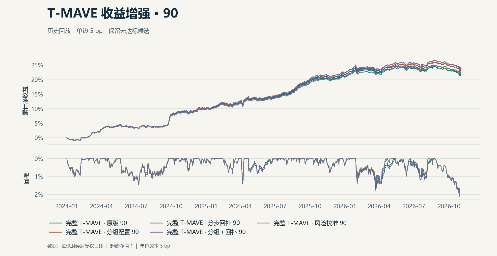

# ChronoETF · 多资产低波配置与 T-MAVE 风险预测

面向数据科学、量化研究和算法实习的可复现研究项目。使用五只境内 ETF，将不规则时间序列建模中的快慢记忆机制迁移到市场风险预测，研究如何在低波动、低回撤约束下提高组合收益。

**已完成数据清洗、时序特征、风险建模、开盘成交回测、消融实验、统计检验及收益增强迭代。** 主要技术为 Python、NumPy、pandas、SciPy 和 Matplotlib。所有业绩均来自历史回放，未宣称实盘收益。

## 核心结果

统一口径：2024-01-02 至 2026-10-30，683 个交易日；周末前收盘生成信号，下一交易日开盘成交；只做多、无杠杆，单边成本 5 bp。

| 版本 | 净年化收益 | 年化波动 | 最大回撤 | 当前定位 |
|---|---:|---:|---:|---|
| 固定 60 日风险预算 | 9.08% | 4.90% | −5.33% | 传统基线 |
| T-MAVE 强控波 | 6.41% | 2.38% | −1.67% | 保留基线 |
| T-MAVE 温和控波 | 7.54% | 2.92% | −2.17% | 保留基线 |
| 完整 T-MAVE 分组配置＋风险校准（强档） | 6.46% | 2.18% | −1.49% | 探索候选 |
| 完整 T-MAVE 分组配置＋风险校准（温和档） | 7.74% | 2.77% | −2.06% | 探索候选 |

强控波相对传统基线降低年化波动 **51.5%**，同时付出 **2.67 个百分点**的年化收益代价。新温和候选在回放中提高年化收益约 **0.20 个百分点**，波动和回撤也较低；但在 2021–2023 开发期年化收益低约 **0.04 个百分点**，未通过预设联合门槛，因此没有替代原版。

新温和候选的年化收益增量，20 日配对区块 95% 区间为 **[−0.30, +0.67] 个百分点**，尚不能确认稳定收益优势。该轮对 19 条策略、三档费用、逐年结果和全部失败候选一并归档。



[本轮全部指标](chronoetf/results/20261116-182855/portfolio_metrics.csv) · [选型门槛](chronoetf/results/20261116-182855/acceptance_gates.csv) · [配对区间](chronoetf/results/20261116-182855/paired_tests.csv) · [冻结版 v0.1.0](https://github.com/cccchensy/ChronoETF/tree/v0.1.0)

## 项目实现了什么

- **数据与执行：** 清洗沪深 300、中证 500、创业板、黄金、5 年期国债 ETF 的后复权 OHLC、成交量及交易状态；统一交易日历，处理停牌与费用，区分信号日和成交日。
- **完整 T-MAVE：** 将动量、下行波动和有符号冲击转化为状态输入；快状态响应新冲击，慢锚点只在重复冲击或权益共振确认时写入。交易日、自然日和滞后一日事件时钟共同推进记忆，遵守先流动、后写入的顺序。
- **风险预测与配置：** 按年扩展训练未来五个开盘区间的方差预测，训练标签严格结束于首次信号之前。结合分组风险预算、资本上限和连续控仓控制敞口。
- **收益增强：** 将股金共同缩放扩展为分组风险预测和双协方差约束配置；研究分步回补、仅用开发期的风险校准以及现金收益敏感性。
- **验证与归因：** 设置 EWMA、固定双记忆、仅交易日、静态缩仓及同敞口对照；报告 5/10/25 bp 成本、收益归因、10/20/40 日配对区块区间及 Holm 多重检验校正。

## 如何理解研究结论

**整套控波策略的效果，与 T-MAVE 机制本身的增量是两件事。** 冻结版强控波把平均股金仓位从 30.05% 降到 15.24%；在匹配平均敞口后，相对动态 EWMA 和固定双记忆的额外降波不到 1%，区间跨零。模型机制的增量仍需独立样本验证。

新实验中的分组配置提高了回放收益，但直接使用会略加深回撤。开发期风险校准将股金仓位分别乘以 0.90 / 0.95 后改善了风险取舍；这一步明确记录为首轮之后的探索性迭代，并未借回放结果重新挑选倍率。

现金净年收益假设为 1% / 2% 时，强控波回放净年化分别为 6.57% / 6.73%。这只是恒定利率情景，未接入真实现金工具，不能作为已实现收益增强。[现金情景](chronoetf/results/20261116-182855/cash_scenarios.csv)

## 可复现与可检查

```powershell
python -m pip install -r requirements.txt
python -B -X utf8 chronoetf/build_data_module.py
python -B -X utf8 chronoetf/backtest.py --vol-target
python -B -X utf8 chronoetf/backtest.py --enhance
python -B -X utf8 chronoetf/audit_enhancement.py chronoetf/results/20261116-182855
```

最后一条审计命令检查发布证据；检查新运行时将目录换为对应的北京时间目录。行情来源可能发生历史修订，复现前需核对 [输入指纹](chronoetf/results/20261116-182855/manifest.json)。本轮独立复算了 **152 组基础费率指标、26,790 条逐日账户和 8,460 条现金情景账户**；核验 72 条训练边界。扰动 2024 年以后的价格和成交量，19 条策略的开发期目标与首次回放目标保持不变。[核验结果](chronoetf/results/20261116-182855/audit.json)

行情范围为 2015-01-05 至 2026-10-30。2021–2023 为开发期，2024–2026 已反复查看，只能作为历史回放。规则冻结后至少积累 126 个新交易日才单列独立评估；当前为 0 个。预测风险约束不保证未来实际回撤上限，回测尚未建立资金规模对应的市场冲击模型。

[完整模型技术手册](ChronoETF_技术手册.md) · [收益增强目标与协议](RESEARCH_GOAL.md) · [各轮研究方法](chronoetf/README.md) · [实验日志](log.md) · [本轮离线研报](chronoetf/results/20261116-182855/report.html)
