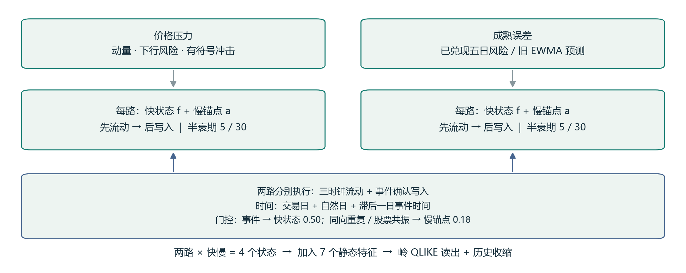
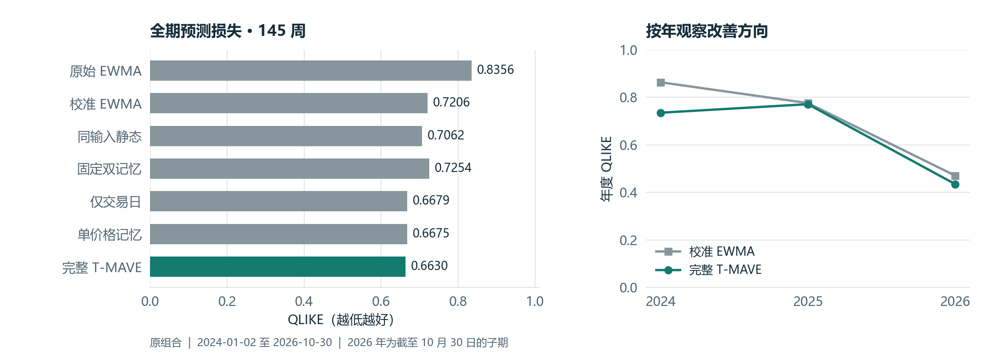
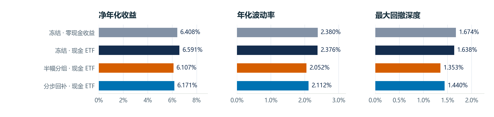

# ChronoETF：T-MAVE 风险预测与多资产配置

**量化研究项目 · Python / NumPy / pandas / SciPy · 样本截止 2026-10-30**

## 1. 项目概览与模型主干

**应用场景。** 多资产组合需要在固定调仓频率下及时识别风险变化，并将预测转化为可执行仓位。ChronoETF 面向股票、黄金、国债的周频配置，构建“风险预测—仓位控制—交易账户”完整流程，研究 **T-MAVE 在共同风险预算与成本下，相对 EWMA 的预测增量及配置效果**。

**核心思路。** EWMA 为近期收益平方分配指数权重；T-MAVE 进一步保存冲击的方向、重复性和预测偏差，用快状态响应近期信息，用慢锚点保留经过确认的变化。价格压力与已经兑现的预测误差共同进入风险读出，随后按历史预测表现决定修正力度。

冻结强控波组合的净年化为 **6.41%**、波动 **2.38%**、最大回撤 **−1.67%**。以 511880 管理闲置资金后，原仓位回放的净年化升至 **6.59%**。三时钟 T-MAVE 分组回补的波动降至 **2.11%**、最大回撤为 **−1.44%**，净年化为 **6.17%**。同现金规则的对照检验衡量风险模型对结果的贡献。

*图 1｜基础组合与执行账户共用，冻结配置和残差研究分别生成风险预测。[模型说明](ChronoETF_技术手册.md#s1)*

**实现范围。** 项目覆盖行情质量处理、分组风险预算、状态更新、逐年训练、成本撮合和统计比较。基础组合先确定资产结构，风险模型再控制股金敞口。最新实验对三个篮子的 **418,770 行**账户复算费用、收益与风险，核对现金 ETF 的成交手数及红利到账日。预测评分、风险预警、净收益与尾部回撤对应模型的各个应用环节。

*图 2｜残差与迁移实验的时间划分。冻结配置的形成期为 2015–2020。[研究协议](TRANSFER_RESEARCH_PROTOCOL.md)*

行情覆盖 **2015-01-05 至 2026-10-30**，共 2,872 个交易日期。原组合采用沪深 300、中证 500、创业板、黄金与国债；迁移实验替换股票篮子。2024–2026 为历史评价窗口，每组 145 个预测周、683 日账户。原组合属于已查看的历史回放，迁移实验按预先固定的资产和规则开展；跨资产比较与时间上的新样本分别记录。

## 2. 完整 T-MAVE 与执行时序

两路输入分别追踪市场压力和预测偏差，每路保存一个快状态和一个慢锚点。三类时间控制状态流动，事件重复与股票共振控制慢状态写入。

*图 3｜双路输入、快慢记忆、确认门控和三时钟共同组成完整 T-MAVE。[状态公式](ChronoETF_技术手册.md#s5)*

**为什么采用双路记忆。** 价格压力将 15/60/120 日动量、下行风险和有符号冲击压缩为候选信号；成熟误差比较旧 EWMA 预测与随后五日已实现风险。前者描述市场变化，后者描述预测偏差。事件首先写入快状态；同向事件重复或股票共振时，慢锚点同步更新。

**预测读出。** 四个状态与七个静态特征进入岭 QLIKE 模型，以 EWMA 为基础学习残差。每年用此前三年成熟的向前预测，从 **0 / 0.25 / 0.5 / 0.75 / 1** 选择修正力度；预测按对数空间收缩至校准 EWMA。修正力度为 0 时使用校准基准，力度为 1 时完整吸收残差预测；中间档位调节两者的权重。特征标准化、事件阈值与收缩选择均使用当时已知的历史信息。

*图 4｜收盘信号、次日开盘成交、五日标签成熟的先后关系；t+k 表示第 k 个后续交易日。[交易实例](ChronoETF_技术手册.md#s8)*

**控仓规则。** 冻结版股金倍率为 `clip(阈值 / 预测波动, 0.35, 1)`。增收实验分别估计股票与黄金方差，沿用国债基础目标，现金按 511880 开收盘价及公告分红记账。原资产单边费用为 **5 / 10 / 25 bp**。

**条件读取与下行约束。** 已确认存在五日风险低估时，读头读取慢锚点。段内限幅限定一次同向冲击序列对慢锚点的累计覆盖。下行版本以信号日股金权重衡量未来五个开盘区间的回撤，并在预测概率超过开发期阈值时把仓位倍率上限降至 0.60。两个预测标签均在第六个后续交易日开盘成熟。

## 3. 原组合：预测增量与误差结构

完整模型相对原始 EWMA 的 QLIKE 改善 **20.7%**；相对校准 EWMA，三个年度的改善方向一致。静态、固定记忆、单价格与仅交易日对照用于识别各组成部分的作用。

*图 5｜全期与分年 QLIKE；2026 年为截至 10 月 30 日的子期。[预测评分](chronoetf/results/20261116-190622/forecast_scores.csv)*

**比较顺序。** 原始 EWMA 与校准 EWMA 的差异反映平均偏差修正；同输入静态模型与记忆模型的差异反映历史状态信息。完整模型的 QLIKE 为 0.6630，静态残差为 0.7062；仅交易日与单价格记忆分别为 0.6679、0.6675。完整结构与简化结构的结果接近，因此两者共同作为机制归因的参照。

*图 6｜两倍低估：实现方差 > 2×预测；两倍高估：预测 > 2×实现。每个模型均评价 145 周。*

两倍低估从原始 EWMA 的 **27 次**降至 **16 次**，两倍高估从 **45 次**变为 **56 次**，呈现风险校准的取舍。相对校准 EWMA 的损失差为 **0.0576**，95% 区间 **[−0.0581, 0.1898]**，Holm p=0.4768。[原样本配对区间](chronoetf/results/20261116-190622/forecast_tests.csv)

**指标含义。** QLIKE 同时考虑风险量级与预测误差，并对严重低估较敏感。平均损失下降与高估次数增加可以同时发生：模型可能在部分时段提高风险估计，从而减少较大的低估损失。图 6 因而把低估与高估分别呈现，帮助判断误差改善来自哪一侧，以及这种变化如何影响后续控仓。

**年度观察。** 2024、2025、2026 年完整模型的 QLIKE 约为 0.7351、0.7709、0.4348，校准 EWMA 约为 0.8631、0.7755、0.4703。各年度改善幅度不同，配对区块区间用于进一步衡量平均差异的估计精度。

## 4. 冻结主干：收益路径与风险取舍

冻结配置采用价格压力快慢记忆与三时钟读出。强／温和档分别对应开发期 **75% / 90%** 的平均股金倍率目标；回放按单边 **5 bp** 计费。

*图 7｜累计净收益与回撤，含 EWMA 及同仓位静态参照；2024-01-02 至 2026-10-30。*

**曲线如何读。** 深蓝为固定 60 日风险预算，亮蓝为 T-MAVE 强控波，橙色为温和控波；紫色虚线为 EWMA，深灰点划线为同仓位静态。上下两个面板的曲线末端均直接标注名称。上图观察净收益积累，下图观察相对历史净值高点的回落，两者使用相同时间轴。

*图 8｜同一评价期的三项指标；回撤以正值深度显示。[组合指标](chronoetf/results/20261116-163605/portfolio_metrics.csv)*

强控波将年化波动从 **4.90%** 降至 **2.38%**，最大回撤深度从 **5.33%** 降至 **1.67%**，对应年化收益从 **9.08%** 变为 **6.41%**。温和档净年化为 **7.54%**、波动 **2.92%**、最大回撤 **−2.17%**，在收益和风险之间提供另一档配置。

**两种静态参照。** 按回放期敞口配平时，强控波相对静态参照的净年化从 5.69% 到 6.41%，波动从 2.55% 到 2.38%，最大回撤深度从 2.34% 到 1.67%。开发期锁定静态倍率后，静态参照在回放期的净年化为 7.34%、回撤深度为 3.85%，平均现金为 7.46%，强控波现金为 14.78%。前者用于同敞口归因，后者展示两条事先确定的策略如何分配风险。

## 5. 跨资产迁移与风险预警

宽基／红利组为 **510050 / 510180 / 510880**；行业组为 **159928 / 159929 / 159930**。黄金与国债共用原样本，模型、窗口、收缩和费用规则在拟合前固定。

*图 9｜共同静态输入下，完整模型与简单记忆的预测损失。[迁移评分](chronoetf/results/20261116-195751/forecast_scores.csv)*

行业组相对校准 EWMA 改善 **6.70%**，三个年度方向一致；宽基／红利差异为 **+0.12%**。单价格与仅交易日模型的结果为结构简化提供参照。行业组三个评价年度的修正力度均为 0.5；宽基／红利组在 2026 年选择 0，回到校准 EWMA。相同收缩规则在不同资产结构下给出不同的修正力度，迁移研究据此观察模型的适用条件。

*图 10｜高风险事件由开发期实现方差 90% 分位定义；各模型按开发期约 10% 提示预算设置阈值。[预警评分](chronoetf/results/20261116-195751/alert_scores.csv)*

行业组保持 **18 次命中**并减少 **2 次误报**；宽基／红利减少一次误报、增加一次漏报。历史评价提示频率为 **37%–41%**，应用层继续跟踪阈值校准。

**预警评价。** 命中表示高风险周被提前提示，误报表示低风险周触发提示，漏报表示高风险周未触发提示。两组实际高风险事件分别为 28 和 34 次；提示预算在开发期设定，回放中的提示频率随风险分布变化。后续应用同时记录命中、误报、漏报和提示频率，比较预警质量与使用成本，并按事先固定的流程评价阈值调整。

## 6. 冻结风险预算内的收益研究

先将股票和黄金按半幅分组配置，再用 511880 管理闲置资金。风险回落后，分组仓位按基础组目标的 **5% / 周**回补，累计上限 **10%**。四套协方差同时约束每周组合预算；股金倍率与回补开关由开发期决定。[预设协议](RESEARCH_GOAL.md)

*图 11｜原篮子 683 日回放，原资产单边 5 bp，现金 ETF 单边 2 bp 且每笔最低 5 元。回撤以深度展示。[三档成本与完整指标](chronoetf/results/20261122-133621/economics.csv)*

**现金贡献。** 同冻结仓位接入现金 ETF 后，净年化增加 **0.183 个百分点**，回放波动和回撤略降；货币 ETF 费率升至 5 bp 后，增幅为 **0.160 个百分点**。开发期的波动为 **2.3297% → 2.3306%**。红利在除息日计入应收，到发放日才可用于买入。

**分组与回补。** 半幅分组把波动与最大回撤深度压到 **2.05% / 1.35%**。回补在 **52 / 146** 个信号周提高仓位，相对半幅增加 **0.064 个百分点**净年化，波动和回撤深度升至 **2.11% / 1.44%**。回补组合相对冻结零收益现金的净年化差为 **−0.238 个百分点**。

*图 12｜原篮子 20 日配对区块重建净值，重复 2,000 次。点为原路径净年化差，横线为 95% 区间。[检验与复算](chronoetf/results/20261122-133621/evidence.json)*

**同预算模型比较。** 三时钟 T-MAVE 相对校准 EWMA 为 **+0.041 个百分点**，95% 区间为 **[−0.146, +0.258]**。相对原始 EWMA 为 **−0.113 个百分点**，五组主区间均跨零。

**迁移与晋级。** 宽基／红利与行业组的开发期选定模型，在回放中的波动分别为 **1.88%** 与 **2.49%**，均低于对应冻结档，净年化为 **5.66%** 与 **5.64%**。三组实测增幅均低于 **+0.20 个百分点**的晋级线。配置采用冻结强／温和档，分组对照及现金账本进入前瞻观察。[技术手册](ChronoETF_技术手册.md#s14)
