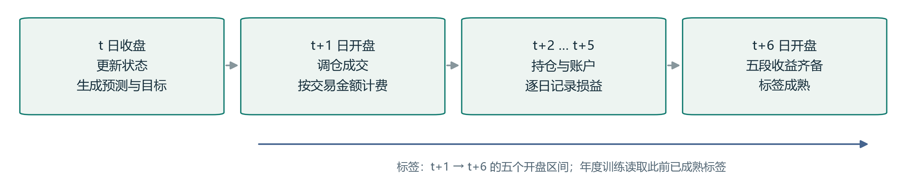
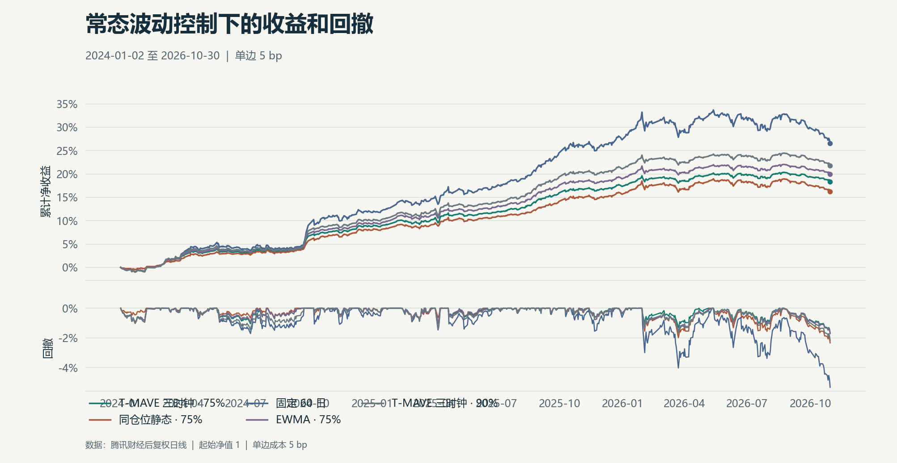
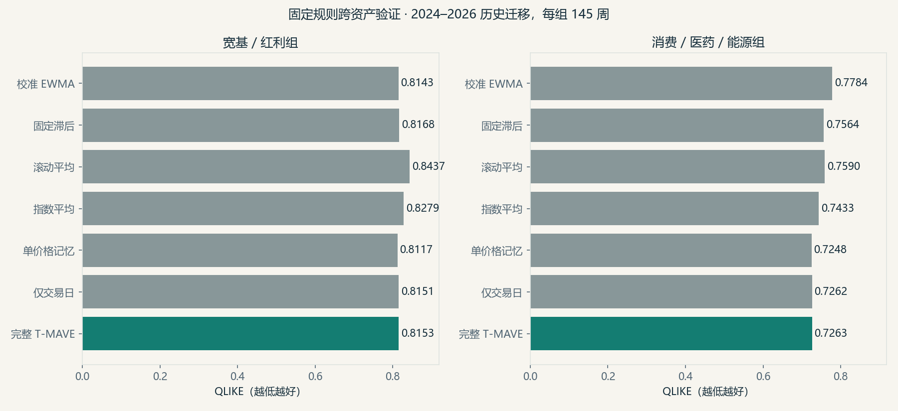
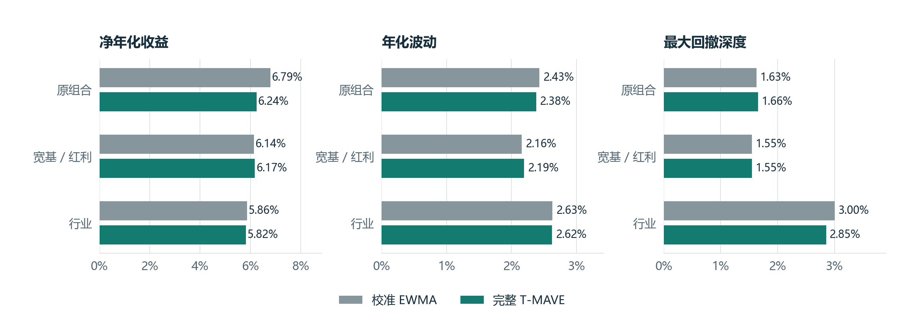
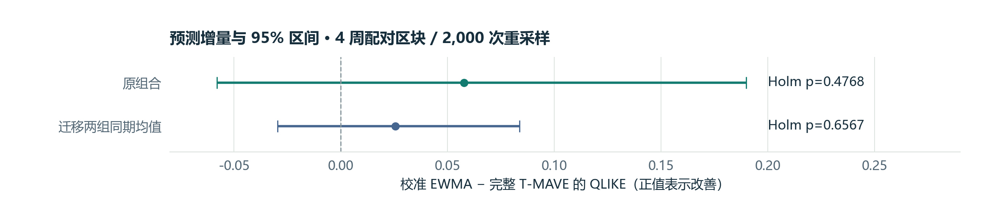

# ChronoETF：T-MAVE 风险预测与多资产配置

**Python · 时间序列建模 · 组合风险管理**

## 1. 项目概览与模型主干

面向股票、黄金、国债的周频配置，构建“风险预测—仓位控制—交易账户”完整流程。研究重点是 **T-MAVE 在共同风险预算与成本下，相对 EWMA 的预测增量及配置效果**。

原组合完整残差模型的 QLIKE 为 **0.6630**，行业迁移组为 **0.7263**，相对校准 EWMA 分别改善 **8.0% / 6.7%**；宽基／红利组接近基准。冻结强控波组合净年化 **6.41%**、波动 **2.38%**、最大回撤 **−1.67%**。预测研究与冻结配置采用各自对应的模型口径。

*图 1｜基础组合与执行账户共用，冻结配置和残差研究分别生成风险预测。[模型说明](ChronoETF_技术手册.md#s1)*

*图 2｜残差与迁移实验的时间划分。冻结配置的形成期为 2015–2020。[研究协议](TRANSFER_RESEARCH_PROTOCOL.md)*

行情覆盖 **2015-01-05 至 2026-10-30**，共 2,872 个交易日期。原组合采用沪深 300、中证 500、创业板、黄金与国债；迁移实验替换股票篮子。2024–2026 为历史评价窗口，每组 145 个预测周、683 日账户。

## 2. 完整 T-MAVE 与执行时序

两路输入分别追踪市场压力和预测偏差，每路保存一个快状态和一个慢锚点。三类时间控制状态流动，事件重复与股票共振控制慢状态写入。

*图 3｜双路输入、快慢记忆、确认门控和三时钟共同组成完整 T-MAVE。[状态公式](ChronoETF_技术手册.md#s5)*

**预测读出。** 四个状态与七个静态特征进入岭 QLIKE 模型，以 EWMA 为基础学习残差。每年用此前三年成熟的向前预测，从 **0 / 0.25 / 0.5 / 0.75 / 1** 选择修正力度；预测按对数空间收缩至校准 EWMA。

*图 4｜收盘信号、次日开盘成交、五日标签成熟的先后关系；t+k 表示第 k 个后续交易日。[交易实例](ChronoETF_技术手册.md#s8)*

**控仓规则。** 股金倍率为 `clip(阈值 / 预测波动, 0.35, 1)`；国债保留基础目标，释放资本进入现金。账户逐日记录隔夜、日内、费用与分组损益，费用覆盖单边 **5 / 10 / 25 bp**。

## 3. 原组合：预测增量与误差结构

完整模型相对原始 EWMA 的 QLIKE 改善 **20.7%**；相对校准 EWMA，三个年度的改善方向一致。静态、固定记忆、单价格与仅交易日对照用于识别各组成部分的作用。

*图 5｜全期与分年 QLIKE；2026 年为截至 10 月 30 日的子期。[预测评分](chronoetf/results/20261116-190622/forecast_scores.csv)*

*图 6｜两倍低估：实现方差 > 2×预测；两倍高估：预测 > 2×实现。每个模型均评价 145 周。*

两倍低估从原始 EWMA 的 **27 次**降至 **16 次**，两倍高估从 **45 次**变为 **56 次**，呈现风险校准的取舍。相对校准 EWMA 的损失差为 **0.0576**，95% 区间 **[−0.0581, 0.1898]**，Holm p=0.4768；区间图见第 6 页。

## 4. 冻结主干：收益路径与风险取舍

冻结配置采用价格压力快慢记忆与三时钟读出。强／温和档分别对应开发期 **75% / 90%** 的平均股金倍率目标；回放按单边 **5 bp** 计费。

*图 7｜累计净收益与回撤，含 EWMA 及同仓位静态参照；2024-01-02 至 2026-10-30。*

*图 8｜同一评价期的三项指标；回撤以正值深度显示。[组合指标](chronoetf/results/20261116-163605/portfolio_metrics.csv)*

强控波将年化波动从 **4.90%** 降至 **2.38%**，最大回撤深度从 **5.33%** 降至 **1.67%**，对应年化收益从 **9.08%** 变为 **6.41%**。温和档在收益和风险之间提供另一档配置。

## 5. 跨资产迁移与风险预警

宽基／红利组为 **510050 / 510180 / 510880**；行业组为 **159928 / 159929 / 159930**。黄金与国债共用原样本，模型、窗口、收缩和费用规则在拟合前固定。

*图 9｜共同静态输入下，完整模型与简单记忆的预测损失。[迁移评分](chronoetf/results/20261116-195751/forecast_scores.csv)*

行业组相对校准 EWMA 改善 **6.70%**，三个年度方向一致；宽基／红利差异为 **+0.12%**。单价格与仅交易日模型的结果为结构简化提供参照。

*图 10｜高风险事件由开发期实现方差 90% 分位定义；各模型按开发期约 10% 提示预算设置阈值。[预警评分](chronoetf/results/20261116-195751/alert_scores.csv)*

行业组保持 **18 次命中**并减少 **2 次误报**；宽基／红利减少一次误报、增加一次漏报。历史评价提示频率为 **37%–41%**，应用层继续跟踪阈值校准。

## 6. 相同风险口径下的经济效果

先在开发期匹配实际波动，再固定参数评价。下图使用强控波档、单边 **5 bp**，分别呈现净收益、实际波动和回撤深度。

*图 11｜三个篮子的风险匹配结果；回放风险偏差随净收益一并展示。[完整指标](chronoetf/results/20261116-195751/portfolio_metrics.csv)*

*图 12｜同期配对损失差及 95% 区间；迁移组先按同一周取平均，再同步抽样。[原组合区间](chronoetf/results/20261116-190622/forecast_tests.csv) · [迁移区间](chronoetf/results/20261116-195751/forecast_tests.csv)*

**结论。** 预测改善集中于原组合和行业组；配置结果体现收益、波动与回撤的共同变化。冻结强／温和档作为配置基线，完整 T-MAVE 与简化记忆并列用于后续预测评价。

**口径。** 行情来自腾讯财经复权接口；两只行业 ETF 的三种复权请求逐条一致。新增六只为事先选定的存续 ETF，迁移两组共享市场日期、黄金与国债。方法细节、成本敏感性和复算入口集中保留在[技术手册](ChronoETF_技术手册.md)与[研究协议](TRANSFER_RESEARCH_PROTOCOL.md)。[A4 排版样式](chronoetf/report_print.css)
