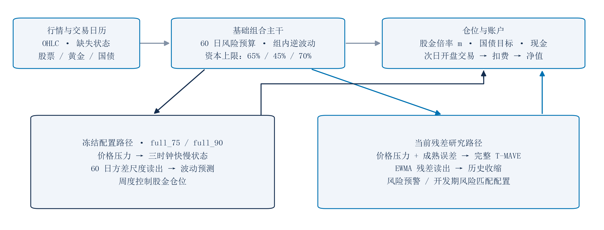
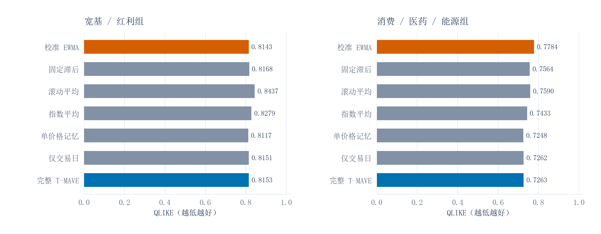
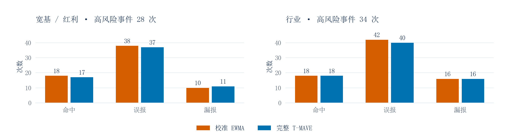
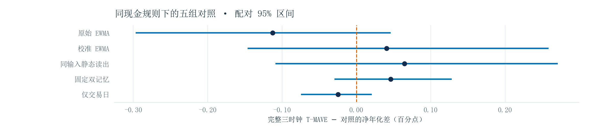

# ChronoETF：T-MAVE 风险预测与多资产配置

**ETF 组合风控研究 · Python · 行情截至 2026-10-30**

## 1. 组合、数据与实验

ChronoETF 以股票、黄金和国债做周度配置。我想检验的是，保留历史冲击的方向和持续性，能否帮助预测未来五日风险，以及这种预测能否改进减仓时点。

基础组合用 60 日协方差给股票、黄金和国债分配风险，股票组内按逆波动分配。T-MAVE 在收盘后更新状态。冻结策略用价格压力预测股金风险，按预测波动缩放仓位。残差实验再加入已经兑现的预测误差，用于修正 EWMA。两条路径都沿用次日开盘调仓。

*图 1｜两条预测路径共用基础组合和交易账户。[模型说明](ChronoETF_技术手册.md#s1)*

原组合包括沪深 300、中证 500、创业板、黄金和 5 年国债 ETF。迁移实验保留黄金与国债，分别换成宽基／红利股票组和行业股票组。三组共用从 2015 年 1 月到 2026 年 10 月的 **2,872 个交易日期**。

*图 2｜残差与迁移实验的时间划分。冻结策略的形成期为 2015–2020 年。[实验协议](TRANSFER_RESEARCH_PROTOCOL.md)*

2021–2023 年用于开发和确定阈值，2024–2026 年用于历史回放。每组有 **145 个可评分预测周、683 个交易日**。实验先比较五日方差预测，再观察相同现金和费用规则下的净收益、波动与回撤。冻结仓位接入现金 ETF 的增收另作归因。

## 2. T-MAVE 的记忆更新与调仓

模型每天更新两类信息。价格压力来自 15／60／120 日动量、下行风险和带方向的冲击。预测误差来自已结束的五日区间，把实际方差与此前发布的 EWMA 预测相比。

*图 3｜快状态先响应冲击，慢锚点在同向事件重复或股票共振时写入。[状态公式](ChronoETF_技术手册.md#s5)*

每路各保留一个快状态和一个慢锚点。状态先按交易日、自然日和事件时间衰减，再写入当天的信号。两路共四个状态，与七个静态特征一起进入带岭惩罚的 QLIKE 回归。

残差读出以年度校准的 EWMA 为起点。每年用此前三年已成熟的向前预测，从 **0、0.25、0.5、0.75、1** 中选择修正力度。力度为 0 时沿用校准 EWMA，为 1 时采用完整的残差预测。

*图 4｜信号在 t 日收盘产生，t+1 日开盘调仓。到 t+6 日开盘，五段收益才齐备。[交易实例](ChronoETF_技术手册.md#s8)*

冻结策略把股金仓位乘以 `clip(阈值 / 预测波动, 0.35, 1)`，国债沿用基础目标。条件读取版本在确认风险低估后才读取慢锚点。另一个版本预测五日高回撤事件，概率超过开发期阈值时把倍率上限压至 0.60。[条件读取与下行试验](ChronoETF_技术手册.md#s13)

## 3. 原组合的五日风险预测

145 个预测周内，完整 T-MAVE 的 QLIKE 为 **0.6630**，原始 EWMA 为 **0.8356**，损失下降 **20.7%**。校准 EWMA 的 QLIKE 为 **0.7206**。它先修正了原始 EWMA 的平均预测偏差，是更接近本研究问题的对照。

*图 5｜QLIKE 越低越好。2026 年子期截至 10 月 30 日。[预测评分](chronoetf/results/20261116-190622/forecast_scores.csv)*

同输入静态读出的 QLIKE 为 0.7062。仅交易日版本和仅价格记忆版本分别为 0.6679、0.6675，均接近完整版本。2025 年完整版本为 0.7709，校准 EWMA 为 0.7755，该年度的点估计差最小。

*图 6｜低估指实际方差超过预测的两倍，高估指预测超过实际方差的两倍。*

从原始 EWMA 到完整 T-MAVE，两倍低估从 **27 次降至 16 次**，两倍高估从 **45 次升至 56 次**。对控仓而言，高估可能过早削减敞口，低估则可能在高风险周保留过多敞口。

相对校准 EWMA，QLIKE 的改善点估计为 **0.0576**，95% 配对区间为 **[−0.0581, 0.1898]**，Holm p 值为 0.4768。三个回放年度的改善方向一致，区间显示幅度仍待复验。[配对检验](chronoetf/results/20261116-190622/forecast_tests.csv)

## 4. 冻结策略的收益与回撤

固定 60 日基准按协方差配置组风险，股票组内采用逆波动。冻结策略在此基础上控制股金敞口，开发期平均倍率目标分别为 **75%**（强控波）和 **90%**（温和控波）。本页按单边 **5 bp** 计费，现金收益记零。

*图 7｜五条策略使用同一时间轴。上图为累计净收益，下图为回撤。名称直接标在各曲线末端。*

强控波把波动从 **4.90% 降至 2.38%**，最大回撤深度从 **5.33% 降至 1.67%**，净年化从 **9.08% 降至 6.41%**。温和档的净年化为 **7.54%**，波动为 **2.92%**，最大回撤深度为 **2.17%**。

*图 8｜2024-01-02 至 2026-10-30。回撤以正值深度表示。[组合指标](chronoetf/results/20261116-163605/portfolio_metrics.csv)*

历史归因还做了两种静态对照。按回放期股金敞口配平时，静态策略净年化为 **5.69%**、最大回撤深度为 **2.34%**，用于观察缩仓时点的贡献。若只用开发期确定静态倍率，回放净年化为 **7.34%**、回撤深度为 **3.85%**。后一种口径对应事先可以锁定的配置规则。

## 5. 跨资产预测与预警

宽基／红利组替换为 **510050、510180、510880**。行业组替换为 **159928、159929、159930**。两组沿用同一预测窗口、收缩规则及费用设置。

*图 9｜模型共用静态输入，比较不同记忆方式。[迁移评分](chronoetf/results/20261116-195751/forecast_scores.csv)*

相对校准 EWMA，行业组的 QLIKE 下降 **6.70%**，三个回放年度方向一致。宽基／红利组的 QLIKE 高 **0.12%**，并在 2026 年选择零修正力度。行业组的仅价格记忆和仅交易日版本与完整模型得分接近。

*图 10｜高风险周指五日实现方差超过开发期第 90 百分位。各模型按开发期约 10% 的提示频率设阈值。[预警评分](chronoetf/results/20261116-195751/alert_scores.csv)*

行业组两种模型均命中 **18 个**高风险周，T-MAVE 少 **2 次误报**。宽基／红利组少一次误报，多一次漏报。回放提示频率为 **37%–41%**，高于开发期预算。下一轮预警比较关注同一提示预算下的漏报率，并记录阈值在新行情中的实际触发频率。

## 6. 闲置现金、分组与分步回补

冻结强控波回放期平均留有约 **14.8%** 现金。现金管理用余款买入银华日利货币 ETF（511880），保留原资产的目标仓位。用不复权开收盘价和公告分红记账，发放日才把红利计入可用资金。相同规则应用于固定 60 日基准时，目标权重合计 100%，回放产生 **0 笔** 511880 成交，净年化仍为 **9.082%**。[账本与基准复算](ChronoETF_技术手册.md#s14)

*图 11｜原篮子 683 日。原资产单边 5 bp，现金 ETF 单边 2 bp，每笔最低 5 元。[回放指标](chronoetf/results/20261122-133621/economics.csv)*

冻结仓位接入现金 ETF 后，净年化为 **6.591%**，增加 **0.183 个百分点**。把现金 ETF 费率提高到 5 bp 后，增量为 **0.160 个百分点**。这两项差额衡量的是闲置资金收益。

把股票和黄金做半幅分组后，波动与最大回撤深度降至 **2.05% 和 1.35%**。分步回补在 **52 个信号周**提高了仓位，净年化从 **6.107% 升至 6.171%**。回补后波动为 2.112%，最大回撤深度为 1.440%，净年化仍比冻结零收益现金低 0.238 个百分点。

*图 12｜20 日配对区块，2,000 次重采样。点为回放净年化差，横线为 95% 区间。[检验证据](chronoetf/results/20261122-133621/evidence.json)*

同一现金和风险预算规则下，T-MAVE 分组回补相对校准 EWMA 的净年化差为 **+0.041 个百分点**，95% 区间为 **[−0.146, +0.258]**。五项主比较的区间均跨零。保留冻结强／温和档，待积累新交易日后按已锁定的规则复验。[预设规则](RESEARCH_GOAL.md)
