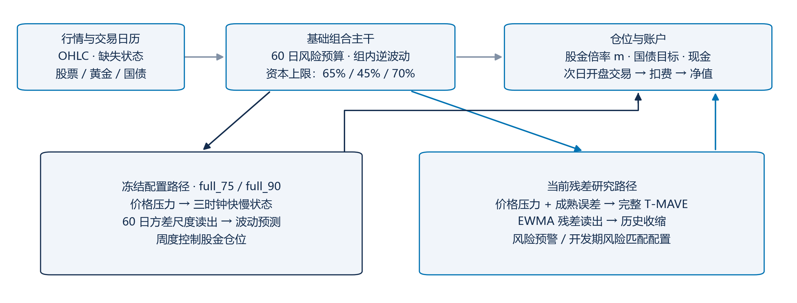
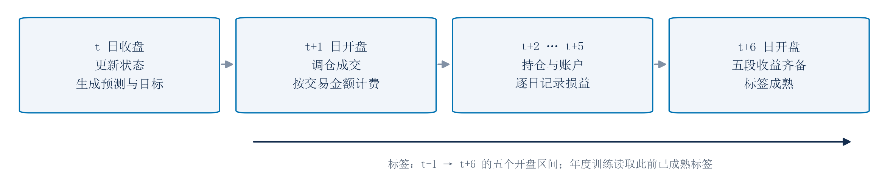
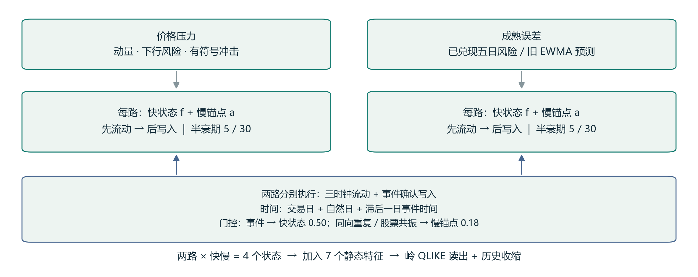
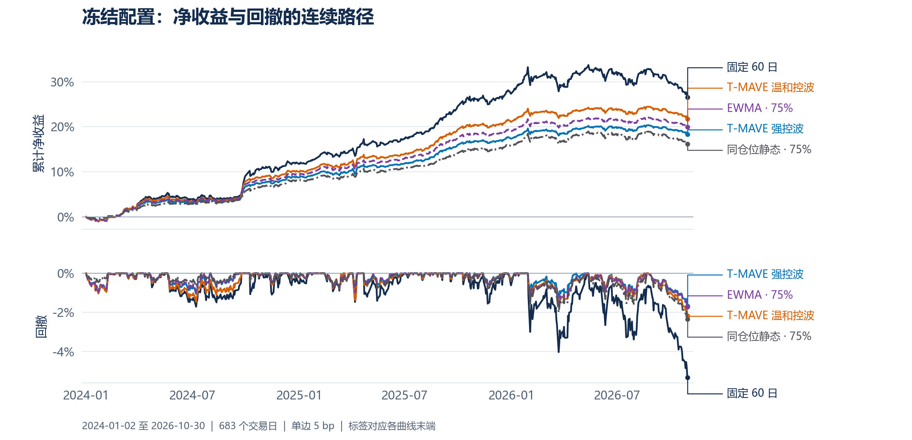
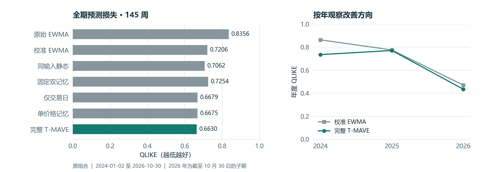
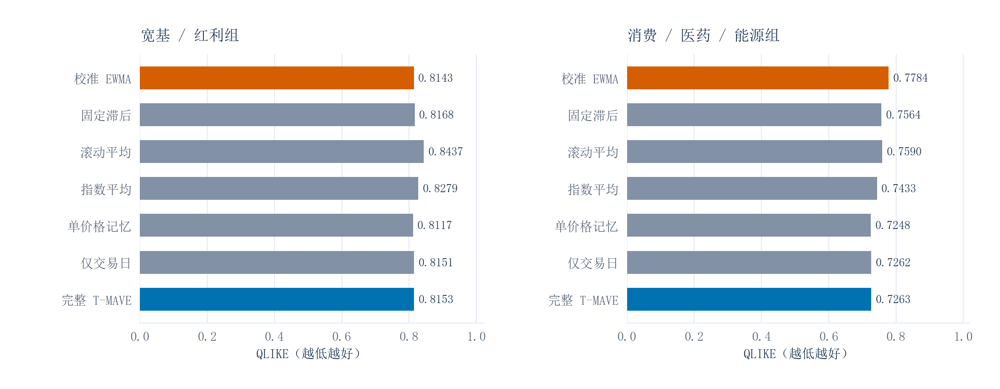
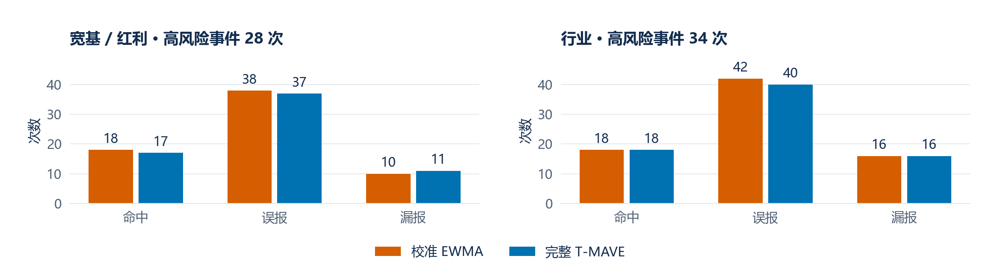
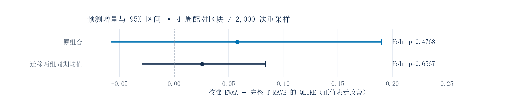
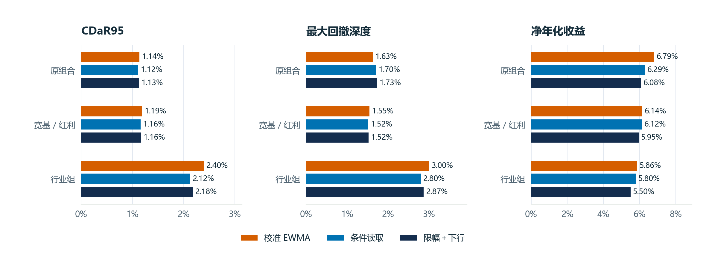
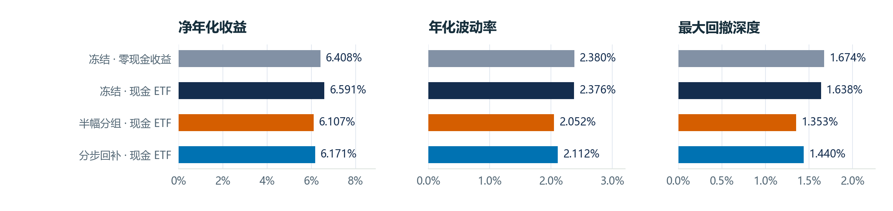

# ChronoETF 技术手册

个人研读版 · 对应六页图解项目报告 · 行情截止 2026-10-30

本手册按“输入—记忆—预测—决策—账户—评价”解释模型。项目报告呈现主要结果，手册保留公式、执行实例和结果入口。当前配置基线为冻结版 `full_75` / `full_90`。分组控仓、现金 ETF 与分步回补的联合实验见 [第 14 节](#s14)。

| 阅读目标 | 对应内容 |
|---|---|
| 理解整个项目 | [1. 架构](#s1) · [2. 数据与时点](#s2) |
| 理解持仓从哪里来 | [3. 基础组合](#s3) |
| 掌握完整 T-MAVE | [4. 两类输入](#s4) · [5. 时间与记忆](#s5) |
| 理解学习与收缩 | [6. 方差预测](#s6) |
| 从预测算到账户 | [7. 仓位与成交](#s7) · [8. 实例](#s8) |
| 阅读当前实验 | [9. 原样本](#s9) · [10. 迁移与预警](#s10) |
| 理解经济效果与统计 | [11. 评价与选择](#s11) |
| 复核六项回撤研究 | [13. 条件读取、慢写与下行约束](#s13) |
| 比较低风险增收与模型贡献 | [14. 分组、真实现金与分步回补](#s14) |
| 运行与查证 | [12. 代码和证据](#s12) |

<a id="s1"></a>
## 1. 模型架构与应用

ChronoETF 每日更新股票、黄金和国债的市场状态，周度生成股金风险预测，并在下一交易日开盘调仓。研究者可以使用风险预测监测高风险时段，也可以将其接入固定的仓位规则，比较收益与风险取舍。



冻结配置以价格压力状态和 60 日方差尺度读出生成风险估计；当前残差研究以价格压力、成熟误差和 EWMA 共同预测。两条路径共用基础组合和执行账户。

基础配置决定组合的资产结构；T-MAVE 决定风险信息如何保存；方差回归决定状态如何影响预测；控仓规则决定预测如何改变持仓。四者分别设置对照，便于归因。

<a id="s2"></a>
## 2. 数据与严格的时间顺序

原组合为 510300、510500、159915、518880、511010，分别代表沪深 300、中证 500、创业板、黄金和 5 年国债。三只股票归为股票组，黄金、国债各为一组。

行情覆盖 2015-01-05 至 2026-10-30，共 2,872 个交易日期。字段为 date、open、high、low、close、volume_lots、status。价格来自腾讯财经复权接口，成交量单位为手；文件指纹保存在各轮 manifest 中。



t+k 表示第 k 个后续交易日。五个开盘收益区间从 t+1 延续到 t+6，标签在 t+6 开盘成熟。

每年的模型只使用首次信号前已经结束的标签。跨阶段标签在评分时剔除，成熟后可进入后续年度训练。

| 版本 | 参数形成 | 训练与评价 |
|---|---|---|
| 冻结版连续控波 | 2015–2020 | 2021 起年度训练；2021–2023 开发；2024–2026 回放 |
| 残差与迁移研究 | 2015–2017 | 2018 起年度向前预测；此前三年预测用于收缩；开发与评价阶段同上 |

缺失价格保持为空。回测对有价格的资产执行交易，并记录延迟订单；账户估值沿用最近有效收盘价。特征按各自有效观察要求计算。迁移能源 ETF 的四个缺失日均位于形成期，标记为来源缺失。

<a id="s3"></a>
## 3. 基础组合：风险预算与资本上限

信号日先按股票最近 60 日对数收益标准差计算组内逆波动权重，最少要求 55 个有效观察：

$$p_{i,t}=\frac{1/\sigma_{i,60,t}}{\sum_j1/\sigma_{j,60,t}}.$$

将当前组内比例投影到过去收益，估计股票、黄金、国债三组协方差，并向对角矩阵收缩：

$$\Sigma_t=0.9S_t+0.1\operatorname{diag}(S_t).$$

`budget_60` 用 60 日协方差，`budget_120` 用 120 日协方差。两者的三组风险预算均为 1/3。求正权重，使每组的方差贡献占比接近预算：

$$\frac{x_j(\Sigma_tx)_j}{x^\top\Sigma_tx}=b_j.$$

求解后应用资本上限：股票 65%、黄金 45%、国债 70%。封顶后的剩余资本按其余组原相对比例分配。国债波动较低，因此通常需要较多资本承担给定风险预算。

2026-10-16 的示例中，封顶后股票、黄金、国债权重约为 14.80%、15.20%、70.00%，对应模型方差贡献约为 51.54%、47.48%、0.98%。后续控仓主要调整股金这一风险来源。

<a id="s4"></a>
## 4. T-MAVE 的两类输入

### 4.1 价格压力

股票组的日收益使用昨日已知的逆波动权重，黄金、国债使用各自收益。由日频组收益构造：

- 15/60/120 日标准化动量，并取三者均值 trend；
- 20 日下行均方根收益，相对昨日 60 日波动得到 relative；
- 当日收益除以昨日波动，得到有符号冲击 z。

以形成期 relative 的中位数 m 为参照，写入候选为：

$$q^{price}_t=-0.4\tanh(trend_t/2)+0.35\tanh((relative_t-m)/0.5)-0.25\tanh(z_t/2).$$

价格压力保存趋势、下行风险与冲击方向。形成期的绝对冲击 90% 分位用于事件判断。

### 4.2 已经兑现的风险误差

组收益的 EWMA 方差递推为：

$$v_t=0.94v_{t-1}+0.06r_t^2.$$

截至 t 日，过去五天的风险已经兑现。将其与五天前的预测比较：

$$e_t=\log\frac{\operatorname{mean}(r^2_{t-4:t})}{v_{t-5}},\qquad q^{error}_t=\tanh(e_t/2).$$

方差下限为 1e−10。正误差表示过去预测偏低，负误差表示过去预测偏高。分母取 t−5，保证旧预测和后续实际风险对齐。误差事件阈值为形成期绝对误差的 90% 分位。

价格压力与成熟误差各自形成一套快慢状态。前者描述市场变化，后者描述预测偏差；残差模型联合读取两路状态。

<a id="s5"></a>
## 5. 完整机制：三时钟、快慢记忆与确认写入



### 5.1 事件与门控

| 事件证据 | 快写入 | 慢写入 |
|---|---:|---:|
| 首次独立组事件 | 0.50 | 0 |
| 当日事件与近五日同方向重复 | 0.50 | 0.18 |
| 至少两只股票 ETF 同向事件共振 | 0.50 | 0.18 |
| 静默日 | 0 | 0 |

本组冲击／误差越过阈值，或股票共振成立，即计为事件。近五日包含当日，重复确认要求至少两次同向事件。价格路径按有符号价格冲击判断方向；误差路径按成熟误差判断方向。共振还要求与股票组方向一致。重复与共振为慢锚点提供确认依据。

事件增量由本组事件、确认状态和其他组事件共同构成：

$$u_{g,t}=I_{g,t}+0.50C_{g,t}+0.25\sum_{h\ne g}I_{h,t}.$$

### 5.2 三类时间

相邻交易日推进 1；自然日间隔 d 乘 5/7；上一日事件增量除以形成期均值。完整时间流为：

$$\delta_{g,t}=0.75\frac{1+(5/7)d_t}{2}+0.25\frac{u_{g,t-1}}{\bar u_g}.$$

首条记录间隔为零。今日收盘事件用于今日写入，下一交易日才进入事件时钟。交易日表示观测步数，自然日反映周末与长假，事件时间反映近期信息活动。

### 5.3 先流动、后写入

设上次快状态为 f、慢锚点为 a，先计算流动：

$$f^-_t=a_{t-1}+2^{-\delta_t/5}(f_{t-1}-a_{t-1}),\qquad a^-_t=2^{-\delta_t/30}a_{t-1}.$$

再用当日候选 q 和门控 g 写入：

$$f_t=f^-_t+g_{f,t}(q_t-f^-_t),\qquad a_t=a^-_t+g_{a,t}(q_t-a^-_t).$$

快状态向上一个慢锚点回归，慢锚点向中性状态衰减；初值为零。候选有界且写入系数位于 0–1，状态保持有界。门控为零时执行纯流动。

两类输入各产生两个状态，共四个；信号日按基础股金比例合成读出特征。国债状态一并保存，股金预测读取股票与黄金的状态。

### 5.4 对照对应什么机制

| 对照 | 保持一致的部分 | 变化部分 |
|---|---|---|
| 固定双记忆 | 候选、状态数量、时间推进、读出 | 写入率采用形成期平均值 |
| 仅交易日 | 候选、动态门控、快慢状态、读出 | 时间流只用交易日 |
| 单价格记忆 | 静态风险输入、训练与收缩 | 记忆只读取价格压力 |
| 固定滞后 | 七维联合静态输入、四个额外特征 | 两类候选各取 1/5 日滞后 |
| 滚动平均 | 同上 | 两类候选各取 5/30 日均值 |
| 指数平均 | 同上 | 两类候选各取 5/30 日半衰期指数均值 |

简单记忆先在资产组层面计算，再按当前股金权重投影。这样可保持记忆输入和状态数量的可比性。

<a id="s6"></a>
## 6. 五日方差读出与历史收缩

### 6.1 标签与损失

将信号日股金权重归一化为 w，并固定到之后的五个开盘区间：

$$y_t=\frac15\sum_{k=1}^{5}\left[w_t^\top\log\left(\frac{O_{t+k+1}}{O_{t+k}}\right)\right]^2.$$

这是组合风险的实现代理。预测评分使用：

$$QLIKE(y,\hat v)=y/\hat v-\log(y/\hat v)-1.$$

QLIKE 越低越好，对严重低估较敏感；同时报告实际/预测比、两倍高估/低估和绝对对数误差，描述不同误差取舍。

### 6.2 残差读出

共同静态输入共七维：5/20/60 日方差相对 EWMA 的对数比、20 日下行方差比的对数（比值加 0.05）、股金 20/60 日相关差、当前成熟误差候选、当前价格压力候选。完整版本再加入四个记忆状态。

每年仅在训练集内标准化，特征截断到 ±3。以 EWMA 为对数方差 offset，拟合 QLIKE＋岭惩罚，非截距惩罚为 0.05‖β‖²，系数边界为 [−2,2]。

校准 EWMA 使用训练集 realized/EWMA 的均值乘数 k：

$$v^{cal}_t=k\,v^{EWMA}_t.$$

原始残差读出限制在校准 EWMA 的 0.5–2 倍，最终按对数空间收缩：

$$\hat v_t=v^{cal}_t\exp\left[\gamma\log\left(v^{raw}_t/v^{cal}_t\right)\right].$$

### 6.3 收缩如何选择

gamma 候选为 0、0.25、0.5、0.75、1。每年只使用此前三年已成熟的向前预测。比较各候选与历史最佳候选在同一周的损失差，以四周分块均值估计标准误；选择平均差位于自身一倍标准误内的最小 gamma。gamma=0 使用校准 EWMA。

首轮绝对损失 one-SE 的结果是全部收缩到零。第二阶段引入成对损失 one-SE 与价格/误差联合状态，并保留首轮和单输入对照，形成当前探索性版本。跨资产实验沿用同一套固定规则。

冻结版 `full_75/full_90` 使用原价格压力快慢状态和 60 日方差尺度读出；当前残差实验使用 EWMA 基础和双路状态。两条研究路径共用基础组合、标签定义与执行引擎。

<a id="s7"></a>
## 7. 从风险预测到仓位和净值

股金倍率为：

$$m_t=\operatorname{clip}(\theta/\sqrt{\hat v_t},0.35,1).$$

股票和黄金基础权重同乘 m，国债目标保持原值，剩余部分留现金。75/90 档表示开发期按股金资本与持有天数加权的平均倍率目标。各轮的比较方式分别保存：

- 冻结版：各预测模型分别校准同档平均倍率，并提供同敞口归因。
- 残差与迁移：共用 EWMA 开发期风险预算；另一条路径仅调阈值常数，把开发期实际波动匹配到 EWMA。

回放期使用已固定阈值，并报告实际风险偏差。现金按零收益处理，交易成本采用单边 5/10/25 bp。

每天的账户顺序为：旧持仓承担隔夜变动 → 按当日开盘净值交易并扣费 → 新持仓承担日内变动 → 记录收盘净值。费用按真实交易金额计算；买卖金额都计入换手。

股票、黄金、国债和费用损益相加等于账户净值变化。停牌资产保留估值与待执行目标，恢复有效行情后按规则处理延迟订单。

<a id="s8"></a>
## 8. 一笔调仓的手算实例

以下采用冻结版 `full_75`：2026-10-16 收盘发信号，10-19 开盘成交，10-26 开盘完成标签。2026 年拟合使用 508 个已成熟训练周。

| ETF | 基础目标 | 强控波目标 |
|---|---:|---:|
| 510300 | 7.8258% | 3.1401% |
| 510500 | 4.1218% | 1.6538% |
| 159915 | 2.8477% | 1.1426% |
| 518880 | 15.2047% | 6.1008% |
| 511010 | 70.0000% | 70.0000% |
| 现金 | 0 | 17.9627% |

股金内股票/黄金比例为 49.32%/50.68%，加权快状态为 0.116964，慢锚点为 0.068582。60 日方差尺度为 0.0001390747，读出线性值约 −0.156736，预测方差为 0.0001188992，折合年化风险约 17.3097%。

强档阈值折合年化 6.94542%，所以倍率约为 6.94542%÷17.3097%=0.401244。黄金目标因此为 15.2047%×0.401244≈6.1008%。

随后五段开盘篮子收益约为 −0.6702%、+0.3116%、−0.6303%、−2.7693%、+0.7918%；平方均值得标签 0.0001847929，对应 QLIKE 约 0.11324。

10-19 上一收盘净值为 1.190807358；开盘净值为 1.190396508，隔夜损益约 −0.000410851。双边换手 1.4606%，5 bp 费用约 0.000008693，日内损益约 +0.000492240，收盘净值为 1.190880055。这个例子把“状态—预测—倍率—成交—账户”连在一起。

<a id="s9"></a>
## 9. 原组合的预测与配置结果



图中深蓝为固定 60 日，亮蓝为强控波，橙色为温和控波，紫色虚线为 EWMA，深灰点划线为同仓位静态。上下两个面板均用引导线连接末端标签。

2024-01-02 至 2026-10-30 的账户覆盖 683 日，预测覆盖 145 个有效周。下表均为单边 5 bp：

| 配置基线 | 净年化 | 波动 | 最大回撤 |
|---|---:|---:|---:|
| 固定 60 日 | 9.0821% | 4.9043% | −5.3294% |
| 冻结强控波 | 6.4083% | 2.3797% | −1.6742% |
| 冻结温和控波 | 7.5363% | 2.9175% | −2.1713% |

强控波相对基础组合年化波动下降 51.5%，年化收益差为 −2.67 个百分点。2026 子期强控波收益约 +0.85%，其中国债贡献约 +1.49 个百分点，股金和费用贡献合计约 −0.64 个百分点。资本权重与风险贡献可分别解释组合表现。



完整残差模型相对原始/校准 EWMA 改善 20.65%/8.00%；三个年度相对校准 EWMA 的方向一致。两倍低估次数依次为 27、20、16，两倍高估次数为 45、59、56，对应原始 EWMA、校准 EWMA、完整模型。完整模型的平均实际/预测比为 1.2422。

当前解释是风险校准的探索性改善。相对校准 EWMA 的 QLIKE 差 95% 区间为 [−0.058070,0.189768]，Holm p=0.4768；相对仅交易日的整体差异约 0.73%。这些数值共同描述效果大小和估计精度。

<a id="s10"></a>
## 10. 跨资产验证与预警用途

### 10.1 数据与模型保持方式

新增宽基/红利组为 510050、510180、510880；行业组为 159928、159929、159930。两组替换原股票位置，黄金和国债继续使用冻结行情。各组按同规则训练，模型结构、窗口、收缩、成本与评价口径在拟合前固定。

两只行业 ETF 的复权请求返回 day 字段；逐段核对前复权、后复权和原价请求的全部价格与成交量一致。质量表保存字段口径、缺失数量和输入指纹。样本属于事先选定的存续 ETF，统计推断以这两组迁移组合为范围。

### 10.2 结果与机制归因



行业组相对校准 EWMA 改善 6.70%，三个年度均较低。宽基/红利整体差异 +0.12%：2024 年较低、2025 年较高、2026 年相同。其 2026 年 gamma=0；行业组三个评价年度的 gamma 均为 0.5。历史收缩在不同资产结构下选择了不同的修正力度。

两组同期平均损失差为 0.025591，4 周区块 95% 区间 [−0.029728,0.083667]，Holm p=0.6567。固定滞后、滚动和指数记忆提供了复杂度参照；单价格和仅交易日结果说明简化结构值得与完整结构长期并列观察。

### 10.3 风险预警如何定义

高风险真值为：未来实现方差超过该篮子开发期实现方差的 90% 分位。主预警按各模型开发期预测的 90% 分位设置提示门槛，开发期提示预算约为 10%；另保留预测超过共同风险阈值的路线。



宽基／红利共 28 次高风险事件，校准 EWMA / 完整模型提示频率为 38.62% / 37.24%；行业共 34 次高风险事件，提示频率为 41.38% / 40.00%。

召回率=命中÷高风险事件；精确率=命中÷全部提示；误报率=误报÷低风险事件。行业组保持相同命中并减少两次误报；宽基/红利组减少一次误报并增加一次漏报。实际提示频率的迁移说明阈值监测是应用层的重要组成。

<a id="s11"></a>
## 11. 经济评价、统计口径与当前选择

### 11.1 经济效果

开发期实际波动匹配后，回放单边 5 bp：

| 组合与预测 | 强档净年化 / 波动 / 回撤 | 温和档净年化 / 波动 / 回撤 |
|---|---|---|
| 原组合 · 校准 EWMA | 6.7907% / 2.4284% / −1.6286% | 7.9038% / 2.9849% / −2.2274% |
| 原组合 · 完整模型 | 6.2446% / 2.3786% / −1.6561% | 7.1879% / 2.8844% / −2.1862% |
| 宽基/红利 · 校准 EWMA | 6.1366% / 2.1581% / −1.5483% | 6.7848% / 2.5969% / −2.0635% |
| 宽基/红利 · 完整模型 | 6.1716% / 2.1925% / −1.5483% | 6.7569% / 2.5748% / −2.0635% |
| 行业 · 校准 EWMA | 5.8644% / 2.6301% / −3.0027% | 6.4253% / 3.2400% / −4.2456% |
| 行业 · 完整模型 | 5.8163% / 2.6204% / −2.8518% | 6.3584% / 3.2053% / −4.0498% |

风险预测描述未来收益的波动幅度。风险较高而收益为正的时段，控仓会同时影响波动与收益，所以应用评价同时保留预测损失、风险偏差和净收益。配置基线继续采用冻结版两档，残差和迁移结果纳入研究报告。

早期收益增强实验研究了分组风险预测、20/60 日收缩协方差的双约束配置、分步回补和开发期风险校准。温和校准候选回放净年化 7.7351%、波动 2.7725%、回撤 −2.0583%；其开发期收益比原版低 0.0397 个百分点。现金 1%/2% 为恒定净利率敏感性情景，作为资金使用效率的补充分析归档。

### 11.2 指标与不确定性



- 净年化收益：净收益复利后按每年 252 日换算。
- 年化波动：日收益样本标准差×√252；夏普使用零无风险利率口径。
- 最大回撤：从历史净值高点到后续低点的最深跌幅。
- CDaR95：最深 5% 的逐日回撤深度平均值。
- 预测检验：同期配对的 2/4/8 周循环区块，4 周为主，2,000 次重采样。
- 经济检验：10/20/40 日配对区块，20 日为主；相关比较采用 Holm 校正。

迁移两组共享市场、黄金和国债。先对同一周的篮子损失差取平均，再同步抽取周区块；有效时间跨度为 145 周。区间用于呈现估计精度，年度和单篮子结果用于描述稳定性。

前瞻评价按冻结规则积累新交易日。126 日约对应 25 个周度预测，是最低观察门槛；评价精度还取决于损失差波动和时间依赖。

<a id="s12"></a>
## 12. 运行、复算与证据入口

```powershell
python -m pip install -r requirements.txt
python -B -X utf8 chronoetf/build_data_module.py
python -B -X utf8 chronoetf/backtest.py --vol-target
python -B -X utf8 chronoetf/backtest.py --residual
python -B -X utf8 chronoetf/transfer_research.py
python -B -X utf8 chronoetf/drawdown_research.py
python -B -X utf8 chronoetf/report_figures.py
```

图解由 `report_figures.py` 从已归档 CSV 生成，主报告采用六页 A4 排版与十二张图。收益路径的精简输入保存在 `report_assets/frozen_paths.csv`，包含五条曲线各 683 日的净值与回撤，便于独立重绘。

**排版与导出。** Markdown 正文经 Python Markdown 转为 HTML，由 Playwright 调用本机 Microsoft Edge 的 Chromium 打印引擎输出 PDF。`report_print.css` 控制 A4 页边距、字体、段落与页内布局；`report_figures.py` 控制图表配色和标签，`export_report.py` 添加页眉页码，并把 PDF 中的证据链接指向 GitHub。当前采用白底、深蓝标题 `#142D4E`、蓝色 `#0072B2` 与橙色 `#D55E00` 的金融研报样式。[三套配色参考](chronoetf/report_assets/palette_reference.png)

本机安装 Edge 后，可用以下命令导出（导出依赖与回测依赖分开安装）：

```powershell
python -m pip install markdown playwright
python -B -X utf8 chronoetf/export_report.py --output "D:/ChronoETF-report.pdf"
```

主报告的项目概览集中解释应用场景、核心思路和实现范围；各结果页补充指标含义、图表读法与经济解释。技术手册进一步保留公式、训练边界、阈值选择和账户手算，便于从报告中的结论追踪到实现。

| 文件 | 阅读重点 |
|---|---|
| [strategy.py](chronoetf/strategy.py) | 风险预算、时间推进、Flow–Jump 和账户归因 |
| [sleeves.py](chronoetf/sleeves.py) | 价格压力、事件与组状态 |
| [volatility_policy.py](chronoetf/volatility_policy.py) | 共同标签、冻结版风险预测与控仓 |
| [residual_policy.py](chronoetf/residual_policy.py) | 成熟误差、联合读出、历史收缩 |
| [transfer_research.py](chronoetf/transfer_research.py) | 新资产、简单记忆、预警和迁移核验 |
| [backtest.py](chronoetf/backtest.py) | 交易时点、费用与逐日净值 |

迁移入口生成新目录并自动完成本轮核验。再次核验可运行 `transfer_research.py --audit <新生成目录>`。GitHub 保存精简证据；完整账户在运行时生成，公开目录中的 audit.json 保存已完成核验结果。

| 实验 | 主要证据 |
|---|---|
| 冻结配置 | [组合指标](chronoetf/results/20261116-163605/portfolio_metrics.csv) · [预测](chronoetf/results/20261116-163605/weekly_forecasts.csv) |
| EWMA 残差 | [评分](chronoetf/results/20261116-190622/forecast_scores.csv) · [训练](chronoetf/results/20261116-190622/train_folds.csv) · [统计](chronoetf/results/20261116-190622/forecast_tests.csv) |
| 跨资产验证 | [质量](chronoetf/results/20261116-195751/data_quality.csv) · [预测](chronoetf/results/20261116-195751/weekly_forecasts.csv) · [评分](chronoetf/results/20261116-195751/forecast_scores.csv) |
| 预警与配置 | [预警](chronoetf/results/20261116-195751/alert_scores.csv) · [组合](chronoetf/results/20261116-195751/portfolio_metrics.csv) · [区间](chronoetf/results/20261116-195751/economic_tests.csv) |
| 研究记录 | [残差协议](RESIDUAL_RESEARCH_PROTOCOL.md) · [迁移协议](TRANSFER_RESEARCH_PROTOCOL.md) · [日志](log.md) |

本轮迁移核验覆盖 1,656 个五日开盘标签、126,900 行账户、180 组全期基础费率指标、27 次手算简单记忆、120 张预警计数表和 216 个训练边界。对行业组扰动后续行情，此前预测、收缩与基础仓位保持一致；原篮子六列已有预测与上轮相同。

阅读顺序可以采用：先按第 8 节复算一笔交易，再按第 6 节追踪一次预测，最后用第 10–11 节理解预测、预警和投资效果之间的联系。

<a id="s13"></a>
## 13. 条件读取、段内慢写与深回撤控制

本轮在同一个固定 60 日风险预算主干上改变风险记忆和仓位约束。三篮子沿用相同交易日期、周度信号和次日开盘成交。2021–2023 年用于读取规则下的风险校准与选择，2024–2026 年用于历史回放。六项检验和晋级门槛在运行前锁定。[持续目标与实验协议](RESEARCH_GOAL.md)

**读入慢状态。** 以最近五个交易日的股金成熟误差事件识别 `confirmed_under`。这一状态对应至少一次确认的正向成熟误差，混合方向单列。两路快状态和七个静态输入照常进入读头。条件策略在该状态下读取两路慢锚点，其余时点在慢状态对应位置输入零。短记忆对照始终输入零，完整模型始终读取。均值、EMA 和过去匹配状态使用同一扇门，分别替换两路慢状态。过去匹配状态只从相同历史波动档且早于当前至少 60 个交易日的信号中抽取。

**给一段冲击设置写入预算。** 每个资产组和输入路径单独跟踪事件方向。相邻同向事件间隔至多四个交易日，视为同一段。记段首锚点的剩余写入系数为 $R$。当日慢写取 $\min(g_{\rm slow},1-0.5/R)$，随后更新 $R\leftarrow R(1-g)$。累计写入替换量至多为 50%。三时钟继续推进衰减，保留系数针对写入项。慢锚点也参与下一日快状态的流动，因此两种写入规则可产生不同的后续快状态。

**预测未来五个开盘区间的最大回撤。** 用信号日固定股金权重构造开盘收益序列，并从单位初始净值计算未来五段最大回撤深度。以逐年训练样本的深度 90% 分位定义高回撤事件。三个同结构岭逻辑读头使用短记忆、条件读取和带限幅的条件读取，输出事件概率。概率超过各读头在开发期的 90% 分位时，把股金倍率上限降到 0.60。训练使用首次年度信号前结束的标签，概率阈值由开发期向前预测确定。

**比较同风险预算下的净效果。** 校准 EWMA 在 75% 与 90% 两档各产生一个共同风险阈值。另一条路径仅调整阈值常数，使开发期 5 bp 下实际波动匹配校准 EWMA。三档成本用同一参数回放。主指标 CDaR95 衡量最深 5% 的逐日回撤，另对照最大回撤、净年化、波动、换手和实际敞口。原篮子另重建冻结两档，用开发期股票与黄金各自的目标资本日固定静态倍率。它与按回放期敞口匹配的历史归因对应不同结果口径。

**识别效果来源。** 段内限幅对照替换慢写入门控，条件读取对照替换慢状态输入，下行对照在同一方差路径上比较带与不带仓位上限。急跌反弹与持续下跌按事后路径划分，分别检查区间净收益、回撤深度和低于或等于 60% 倍率的交易日数。配对区块在三个篮子使用共同日期索引，逐次重建净值再计算风险差。

### 13.1 六项实验的读数

| 篮子 | 校准 EWMA QLIKE | 完整读取 | 条件读取 | 仅短记忆 |
|---|---:|---:|---:|---:|
| 原组合 | 0.7206 | 0.6630 | 0.6489 | 0.6436 |
| 宽基／红利 | 0.8143 | 0.8153 | 0.8116 | 0.8175 |
| 行业 | 0.7784 | 0.7263 | 0.7026 | 0.7145 |

每个篮子 145 个回放周。条件读取相对校准 EWMA 的三篮子同期平均 QLIKE 差为 −0.0501，4 周配对区块 95% 区间为 [−0.1220, 0.0068]。条件读取相对短记忆的同期差为 −0.0042，区间为 [−0.0242, 0.0105]。条件读取与均值、EMA、过去匹配状态的详细评分保存在证据文件。宽基／红利在 12 个确认低估周中，完整读取 QLIKE 为 1.1552，条件读取为 1.4144，说明触发规则仍有资产差异。



| 75 档、5 bp、历史回放 | CDaR95 参照 → 条件读取 | 回撤深度参照 → 条件读取 | 波动参照 → 条件读取 | 净年化参照 → 条件读取 |
|---|---:|---:|---:|---:|
| 原组合 | 1.1385% → 1.1153% | 1.6286% → 1.7049% | 2.4285% → 2.3746% | 6.7910% → 6.2910% |
| 宽基／红利 | 1.1913% → 1.1592% | 1.5489% → 1.5187% | 2.1587% → 2.1452% | 6.1378% → 6.1234% |
| 行业 | 2.3958% → 2.1237% | 2.9999% → 2.8026% | 2.6286% → 2.6250% | 5.8625% → 5.7960% |

行业 CDaR95 的差为 −0.2721 个百分点，20 日配对区块的 95% 区间为 [−0.2255, 0.2122] 个百分点。点估计来自原时间顺序，区间来自重建的路径。行业组短记忆参照的 CDaR95 为 2.1136%、最大回撤深度 2.7877%、净年化 5.8526%，可并列作为风控基准。条件读取和限幅版本满足行业回放的 5/10 bp 联合门槛。原组合开发期的四个候选 CDaR95 降幅均低于 5% 晋级线，配置选择采用冻结版两档。

**写入限幅与下行约束。** 三个篮子的成熟误差路径与价格路径分别有 498 和 49 次慢写受到限幅。在行业组，5 bp 条件读取加限幅后的 CDaR95 为 2.1278%，再加下行上限为 2.1802%，对应年化 5.7923% 和 5.5016%。在行业组 3 个持续下跌窗口，叠加下行后平均净损失由 0.454% 收窄到 0.415%。在其 3 个急跌反弹窗口，平均净收益由 0.509% 变为 0.490%。整个行业组回放的条件下行读头提示 31 次，命中 20 个高回撤事件中的 3 次。实际提示频率、窗口损益和全年净收益共同反映了追加约束的代价。

**事前静态对照。** 强档在开发期锁定股票倍率 75.80%、黄金倍率 74.38%。回放时该静态组合的净年化为 7.3357%、波动 3.7041%、最大回撤 −3.8521%，平均现金 7.4623%。冻结强档分别为 6.4083%、2.3797%、−1.6742% 和 14.7832%。按回放阶段目标资本日重新配平所得的旧静态参照为 5.6913%、2.5530%、−2.3390%，属于同阶段敞口归因。两组比较共同展示了仓位水平和仓位时机的影响。

**复算。** 运行 `python -B -X utf8 chronoetf/drawdown_research.py`。输出含各臂预测、年度训练边界、三档费用指标和逐日账户。核验覆盖两种标签各 1,656 个、5 bp 账户 191,760 行、216 个训练边界和 1,788 个旧预测值。行业行情在 2025-06-30 之后扰动，之前 485 个信号的方差预测、下行概率、基础仓位与匹配来源一致。前瞻窗口从 2026-11-21 之后开始，本次输入截止 2026-10-30。[组合指标](chronoetf/results/20261121-235427/economics.csv) · [区间、选型和数据指纹](chronoetf/results/20261121-235427/evidence.json)

<a id="s14"></a>
## 14. 冻结风险预算内的收益研究

本轮以 `frozen_75` 为风险参照，依次衡量资产分组、真实现金收益和分步回补。2021–2023 年的 727 个交易日用于选型，2024-01-02 至 2026-10-30 的 683 日用于历史回放。完整三时钟指冻结版及本轮分组预测所用的价格压力快慢状态、确认写入与三类时钟。双路 EWMA 残差和条件慢状态继续由第 6 和第 13 节描述，上一轮共同预算条件读取作为本轮额外对照。

### 14.1 预测、半幅配置及回补

股票组以信号日固定权重投影三只资产，黄金单独计算。各预测器使用相同五段开盘收益的实现方差标签，每年仅用边界前已成熟的标签学习。比较原始 EWMA、年度校准 EWMA、同输入静态读出、固定双记忆、仅交易日及完整三时钟。校准 EWMA 乘以训练期“实现方差 ÷ 原始 EWMA”比率的均值。

对每个信号，冻结目标为向量 $w_0$。模型组方差与共同 60 日组方差各配上 20 日和 60 日收缩相关矩阵，形成四套协方差 $\Sigma_k$。配置器在股金基础上限、国债原目标以及各项 $w^\top\Sigma_k w \le w_0^\top\Sigma_k w_0$ 内，求接近基础配置并约束调整幅度的目标 $w_*$。半幅目标为 $(w_0+w_*)/2$；随后在 0.85 至 1.00 的七档股金倍率上，以可行线段裁剪。原组合及宽基／红利完整模型选为 **0.85**，行业组为 **0.975**。每个模型都在开发期以两套现金规则及 5/10 bp 同时筛选年化波动、最大回撤深度、CDaR95，再按 5 bp 现金工具模式下的净年化选档。

一个组的 5 日方差不高于 20 日方差，且连续两个信号的预测方差不高于 60 日参考时，允许每周增加该组基础目标的 5%，累计至 10%。回补以实际可行增量递推，四项风险上限继续约束每一周。失去资格时恢复半幅目标。用同一倍率复算两臂，原组合及宽基／红利在开发期选择回补，行业组选择半幅。原篮子完整模型的 298 个信号周中，分组求解器有 38 周沿用冻结目标再做股金倍率校准。回放有 146 个交易信号周，末周的五日标签在数据截点处尚未成熟，回补实际提高仓位 52 周。事后划分的 3 个急跌反弹窗口中，11 日净收益均值为半幅 **0.327%**、回补 **0.319%**。[求解记录与压力窗口](chronoetf/results/20261122-133621/evidence.json)

### 14.2 真实现金工具与资金使用

现金组买入银华日利 A 类场内份额（511880），使用 2020-12-31 至 2026-10-30 的 **1,411 条不复权日线**及五次发行人公告。风险资产沿用原账户的连续份额模拟。500 万元起始账本中，现金 ETF 按 100 份整手和开盘价代理撮合。每笔收取成交额的 2 bp 且最低 5 元，压力口径为 5 bp。先卖风险资产，若买单资金仍不足就卖出足够整手的现金 ETF，再买风险资产。无现金 ETF 卖单的调仓日，用剩余资金买入可负担的整手。[上交所交易说明](https://edu.sse.com.cn/etfgame/gametopic/c/4940402.shtml) · [交易最小单位](https://www.sse.com.cn/assortment/fund/etf/question/)

以登记日持有 100 份 511880 为例，2025 年 12 月 31 日除息时，账本记录 **115.53 元应收**；2026 年 1 月 7 日发放时，应收转入可用资金。场内卖出款可以当日场内使用。每个阶段从同额现金起步，阶段内登记日的份额决定分红权利。每日按收盘价盯市，核对风险资产、货币 ETF、可用现金及应收账款之和等于净值。价格来自历史开盘撮合代理，费用为回测设定。[2025 年分红公告](https://www.sse.com.cn/disclosure/fund/announcement/c/new/2025-12-26/511880_20251226_IIQW.pdf) · [其余公告与价格指纹](chronoetf/results/20261122-133621/evidence.json)

### 14.3 结果与决策

原组合历史回放，原资产单边 5 bp、货币 ETF 单边 2 bp。CDaR95 是最深 5% 交易日的平均回撤深度。

| 策略与账本 | 净年化 | 波动 | 最大回撤 | CDaR95 |
|---|---:|---:|---:|---:|
| 冻结强控波 · 零收益现金 | 6.408% | 2.380% | −1.674% | 1.080% |
| 冻结强控波 · 现金 ETF | 6.591% | 2.376% | −1.638% | 1.052% |
| 半幅分组 · 零收益现金 | 5.892% | 2.055% | −1.393% | 0.881% |
| 半幅分组 · 现金 ETF | 6.107% | 2.052% | −1.353% | 0.855% |
| 分步回补 · 零收益现金 | 5.963% | 2.115% | −1.476% | 0.928% |
| 分步回补 · 现金 ETF | 6.171% | 2.112% | −1.440% | 0.900% |

在原冻结目标上，现金 ETF 平均占净值 **14.69%**，增加净年化 **0.183 个百分点**。现金费率压力口径下增幅为 **0.160 个百分点**。开发期接入货币 ETF 后，冻结净年化为 **2.1301% → 2.2609%**，年化波动为 **2.3297% → 2.3306%**，最大回撤深度为 **1.8135% → 1.7710%**。同样接入现金 ETF，半幅分组相对冻结年化少 **0.484 个百分点**；回补收回 **0.064 个百分点**。原组合完整模型通过开发和回放的三项风险门槛，净年化相对冻结零收益现金为 **−0.238 个百分点**，相对同现金工具冻结为 **−0.420 个百分点**。三个篮子的选定完整模型均在冻结风险边界内，回放收益增幅均低于总系统晋级线。冻结强／温和控波继续作为配置基线。



### 14.4 模型优势检验与复现

各模型共享资产、四项约束中基于历史方差的两个共同风险上限、现金工具、交易频率和费用。另两个上限采用各自预测值。每个模型独立按同一开发规则选型，回放的实际持仓和风险会随预测变化。原篮子主检验对同日净收益取 20 日循环区块，2,000 次重建净值。主比较为 5 bp 净年化差，另记录 10 bp 方向、10/40 日区块和回撤／波动差。主比较对五项 p 值做 Holm 校正。两组迁移篮子使用相同的日期抽样。

| 对照 | T-MAVE 年化差（百分点） | 95% 区间（百分点） |
|---|---:|---:|
| 原始 EWMA | −0.113 | [−0.297, +0.046] |
| 校准 EWMA | +0.041 | [−0.146, +0.258] |
| 同输入静态 | +0.065 | [−0.109, +0.271] |
| 固定双记忆 | +0.046 | [−0.029, +0.128] |
| 仅交易日 | −0.025 | [−0.075, +0.021] |

原组合对校准 EWMA 的点估计在 10 bp 仍为 **+0.032 个百分点**，五项主区间均包含 0，校正 p 值均为 1.000。宽基／红利点估计均偏向对照；行业组相对固定双记忆的差为 **+0.014 个百分点**，Holm p 为 **0.245**。可报告的结果是同现金规则下的风险与收益取舍，以及冻结仓位下现金管理的回放增量。三时钟相对现有模型的收益优势留待锁定样本检验。

```powershell
python -B -X utf8 chronoetf/constrained_return.py
```

入口生成分篮子开发网格、年度训练边界、每周组仓位、逐日账本、三档费用表、检验证据和两幅图。账本复算覆盖 **418,770 行**，包括红利应收与支付时点、整手、费用及净值。原篮子三条旧策略的 18 条分阶段成本记录与归档一致。前瞻窗口从 **2026-11-22** 后开始，本轮为 0 个新交易日；取得同口径新增行情后按公告续录现金分红，沿用已固定的选型及风险/成本规则，累计至少 126 日单列检验。[结果表](chronoetf/results/20261122-133621/economics.csv) · [核验与配对区间](chronoetf/results/20261122-133621/evidence.json) · [冻结协议](RESEARCH_GOAL.md)
