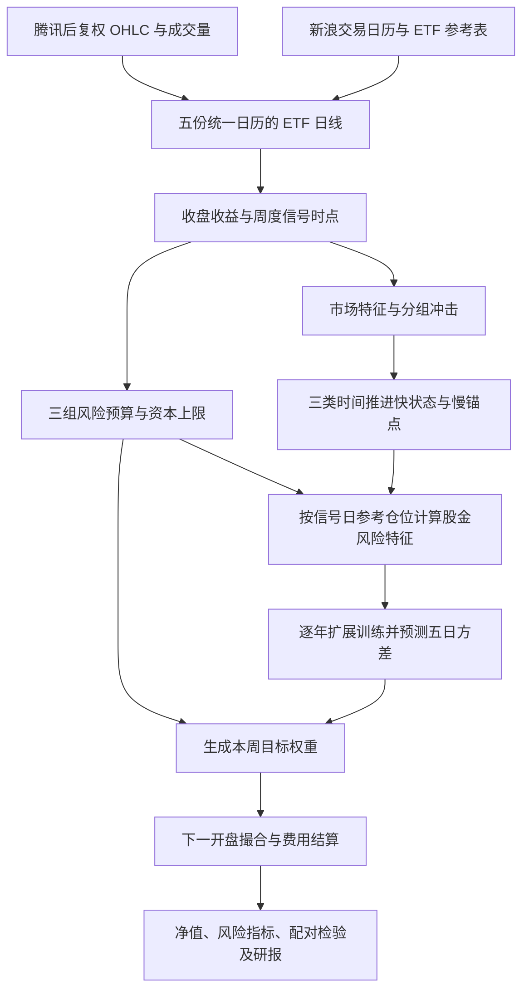
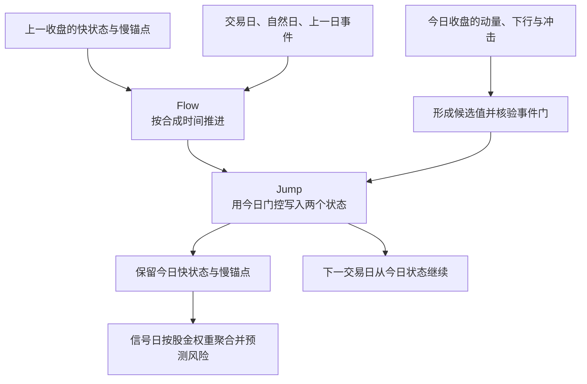
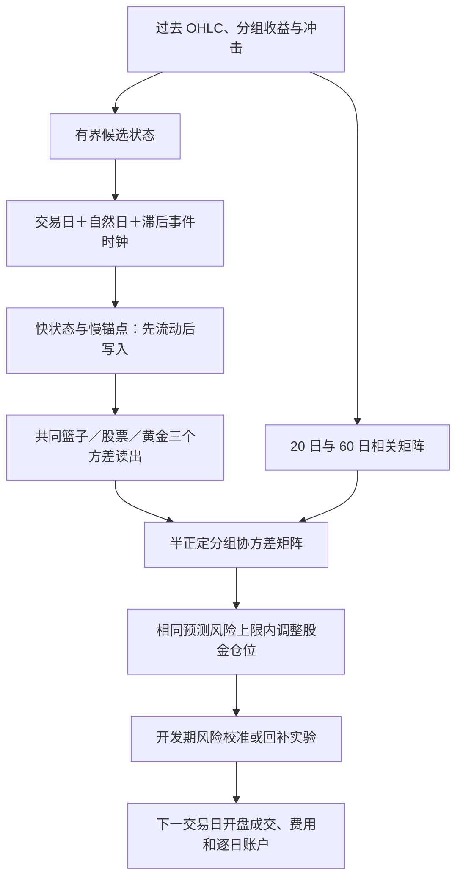

# ChronoETF 技术手册

个人研读版 · v0.1.0 基线及 2026-11-16 收益增强迭代 · 行情截止 2026-10-30

**当前状态：保留原强控波、温和控波作为正式研究基线。** 新分组配置＋风险校准在历史回放中呈现更好的收益风险取舍，但开发期未通过联合门槛，属于待独立验证的候选。前 15 节完整解释冻结版；新增第 16–18 节解释增强实验、复核方法与最终取舍。

| 我想先搞懂什么 | 从哪里读 |
|---|---|
| 这个项目到底在解决什么问题 | [§1 研究问题](#s1) · [§2 架构](#s2) |
| 五只 ETF 为什么这样选，行情怎么处理 | [§3 标的](#s3) · [§4 数据](#s4) |
| 什么时候读什么数据、怎么决定下周持仓 | [§5 时序](#s5) · [§6 风险预算](#s6) |
| 因子、T-MAVE、方差回归、75% 档各管什么 | [§7 因子](#s7) · [§8 T-MAVE](#s8) · [§9 预测与控仓](#s9) |
| 想自己从日线算出一笔调仓和净值 | [§10 调仓实例](#s10) · [§11 回测引擎](#s11) |
| 想判断收益、夏普、回撤和显著性 | [§12 结果与归因](#s12) · [§13 消融与统计](#s13) |
| 想和自己的 T-MAVE 科研、简历和面试串起来 | [§14 研究迭代与连续性](#s14) · [§15 复现与追问](#s15) |
| 为什么收益增强保留了完整 T-MAVE、如何分别配置股金 | [§16 增强模型](#s16) |
| 新方案赚了多少、为何仍未替换原版 | [§17 结果与选择](#s17) |
| 如何复核现金、训练边界与未来信息泄漏 | [§18 复核与后续](#s18) |

<a id="s1"></a>
## 1. 研究问题与冻结版定位

ChronoETF 是一个**五只境内 ETF 的周频多资产配置策略**。目标是保留股票与黄金提供收益的机会，同时在两组风险升高时降低敞口，观察组合能少承受多少波动和回撤，以及要付出多少收益。模型每天更新特征，周度决定仓位，下一交易日开盘模拟成交，账户每天结算。

| 层 | 输入 | 输出 | 要回答的问题 |
|---|---|---|---|
| 基础配置 | 五只 ETF 的收盘收益、三组协方差和资本上限 | 五只 ETF 的基础权重 | 在分组约束下怎样配置可交易资产 |
| 风险预测 | 基础持仓中的股金比例、近期风险、T-MAVE 快慢状态 | 这只股金篮子未来五个交易日的日均方差估计 | 当前股金风险相对近期历史水平会上升还是下降 |
| 仓位与账户 | 风险估计、开发期校准的阈值、下一开盘价和成本 | 最终权重、每日净值、收益、夏普、回撤 | 控仓带来的低波动值不值得承担收益代价 |

**`budget_60` 和 `budget_120` 都是传统配置基线。** 冻结版以 `budget_60` 为主干，在风险预测层加入 T-MAVE。`full_75` 和 `full_90` 两档共用同一个风险预测，区别是股金风险阈值和控仓强度。75% 和 90% 指开发期的股金仓位加权平均倍率。整个组合的目标权重随市场变化。

在 2024-01-02 至 2026-10-30 的 683 日历史回放中，单边 5 bp 下，`full_75` 相对 `budget_60` 把年化波动从 **4.90% 降至 2.38%**、最大回撤从 **−5.33% 收窄至 −1.67%**，净年化收益从 **9.08% 降至 6.41%**。这是整套控波策略相对原主干的效果。T-MAVE 状态机制本身的独立贡献，要看同因子、同仓位的对照。[冻结版结果](https://github.com/cccchensy/ChronoETF/tree/v0.1.0/chronoetf/results/20261116-163605)

<a id="s2"></a>
## 2. 工程和研究架构



冻结版是一个 Python 研究流水线。日线、参数、权重和回测结果通过本地文件管理。`backtest.py --vol-target` 是最终模型的运行入口，每次运行形成一个以北京时间命名的结果目录。数组矩阵运算用 NumPy，日历对齐和时序用 pandas，拟合用 SciPy，图用 Matplotlib，交易日历经 AkShare 获取。

| 文件 | 它在流水线里负责什么 | 读代码从哪里开始 |
|---|---|---|
| [prepare_daily.py](chronoetf/prepare_daily.py) | 下载接口直接返回的行情，分段、解析、校验和写 CSV | `download`、`clean_bars`、`load_history` |
| [build_data_module.py](chronoetf/build_data_module.py) | 补齐共同交易日索引，生成五只 ETF 日线文件 | `get_calendar`、`clean_etf`、`build` |
| [market_reference.json](chronoetf/market_reference.json) | 日期范围、基金代码与交易所、停牌、分红及份额调整 | `coverage`、`securities`、`suspensions` |
| [backtest.py](chronoetf/backtest.py) | 装载数据、路由实验、下一开盘撮合、计算净值和基础指标 | `load_market`、`trade_at_open`、`simulate`、`metrics` |
| [strategy.py](chronoetf/strategy.py) | 传统风险预算、资本上限、时间流、配对重采样和损益归因 | `allocations`、`allocate_budget`、`cap_groups`、`time_flow`、`flow_jump`、`annotate_account` |
| [sleeves.py](chronoetf/sleeves.py) | 股票、黄金、国债的因子与事件状态，发布实验的共用回测 | `group_returns`、`build_factors`、`fixed_session_states`、`evaluate_sleeves` |
| [risk.py](chronoetf/risk.py) | 通用 QLIKE 和岭惩罚方差回归，也服务于早期逐资产模型 | `fit_readout`、`qlike` |
| [volatility_policy.py](chronoetf/volatility_policy.py) | 冻结版的一条完整链路，从周度风险样本到组合波动检验 | `run_volatility_policy`、`risk_inputs`、`fit_sleeve_forecasts`、`risk_books`、`risk_tests` |
| [tmave.py](chronoetf/tmave.py)、[horizon.py](chronoetf/horizon.py) | 为当前入口提供时间切分、周度下单时点、CDaR 和 Holm 校正，并保留早期实验入口 | `period_ranges`、`weekly_signals`、`cdar`、`holm_adjust` |
| [allocation_alpha.py](chronoetf/allocation_alpha.py)、[event_policy.py](chronoetf/event_policy.py) | 研究股金相对收益与重复负冲击路由的历史分支 | `--alpha`、`--event-risk` 实验入口 |
| [report.py](chronoetf/report.py) | 离线 HTML 研报、收益回撤图、组合比较图和链接 | `write_volatility_report` |

阅读最终模型时，先顺着 `run_volatility_policy` 追一遍调用图，再去看 `risk_inputs`、`build_factors` 和 `fit_readout` 的公式。早期分支用于理解研究迭代，同名状态和对照在各轮实验中的口径以各自入口为准。

<a id="s3"></a>
## 3. 为什么是这五只 ETF

### 3.1 选择逻辑

五只标的覆盖股票、黄金和国债三类不同风险来源。三只股票基金帮助覆盖不同股票风格，也给冲击共识规则提供多个观测。黄金和国债各占一个资产组，三类资产都能用相同的境内交易日历和开盘执行规则。这五只基金在起始日期前已经上市，覆盖了完整的研究窗口。

| 代码 | 标的及其角色 | 主要风险来源 | 2015–2026 全窗年化波动 | 2026 年化波动 | 2026 持有收益 |
|---|---|---|---:|---:|---:|
| `510300` | 华泰柏瑞沪深 300 ETF，大盘股票代表 | 大盘权益盈利、估值和共同市场风险 | 20.77% | 15.36% | −10.27% |
| `510500` | 南方中证 500 ETF，补充中盘权益 | 中盘企业盈利、估值和风险偏好 | 26.84% | 27.81% | −13.83% |
| `159915` | 易方达创业板 ETF，补充偏成长风格 | 风险偏好及成长行业集中和估值波动 | 34.36% | 36.46% | −23.56% |
| `518880` | 华安黄金 ETF，境内人民币黄金敞口 | 金价、实际利率及人民币计价的传导 | 15.41% | 31.35% | −12.76% |
| `511010` | 国泰上证 5 年期国债 ETF，低波动利率资产 | 利率和久期，收益来自票息及债券价格变化 | 2.25% | 0.68% | +2.11% |

单标的表按冻结的后复权收盘序列计算，停牌日在持有统计中沿用上一有效收盘估值。日收益样本标准差乘 $\sqrt{252}$，2026 持有收益以 2025 年末为起点，截至 2026-10-30。表内未扣策略模拟成本。国债基金在利率上行时也会承受价格下跌。黄金的分散价值随环境变化，2026 子期黄金和股票都下跌。[五只基金的参考文件](chronoetf/market_reference.json) · [上金所黄金 ETF 说明](https://www.sge.com.cn/cpfw/hjetf) · [511010 2026 年三季报](https://www.sse.com.cn/disclosure/fund/announcement/c/new/2026-10-27/511010_20261027_RYVD.pdf)

### 3.2 为什么把三只股票归到一组

2026 子期，三只股票 ETF 的日收益两两相关约 **0.86–0.88**，黄金和三只股票的日收益相关约 **0.25–0.46**。三只股票有显著共同市场风险。把它们作为一个股票组，能在分配资金时避免把三个高相关标的视为三份独立风险来源。组内再做逆波动加权，决定给大盘、中盘和成长各多少。

股票的共识信号同样利用三只基金。两只以上同时超出各自正阈值或负阈值、方向又与股票组一致时，模型把这个冲击视作较可信的共同证据。三只基金的相关性较高，因此这个规则读作**市场宽度的代理**，两票共享很大一部分市场信息。

### 3.3 为什么用周频配置，境外数据有什么位置

项目使用日线和连续数十日的波动估计，交易视角是周频配置。周内状态保留信息，周度下单节奏减少高频交易摩擦，也允许用统一的开盘价格模拟。五只 ETF 中黄金已经引入与国内股票不同的风险驱动。冻结版统一境内资产、交易日历、币种和可成交时点，便于归因。

如果以后测试境外数据，先定义它是**信号**还是**可交易资产**。作为信号，把美债利率、海外金价或境外权益收益映射到中国收盘前已可知的最后时点，可以检验对股金风险预测的额外价值。作为资产，需另外建模时区、可成交市场、人民币汇率、跨境基金跟踪和折溢价。两个问题分别改变信息集和交易集合，对照实验也要各自保持其他条件一致。

这五只 ETF 是事先指定的研究池。结论覆盖这组长期可观测资产和这一段历史。对大资产池的普适性，需要用提前固定的候选产品和基准做检验。

<a id="s4"></a>
## 4. 数据来源、复权和清洗

### 4.1 输入和固定格式

- 行情源为腾讯财经的 `fqkline/get`，请求日线及 `hfq`，直接解析响应中的 `hfqday`。以不超过两个日历年的区间分批，控制在单次 640 行上限以内，各段按左闭右开拼接。
- `akshare.tool_trade_date_hist_sina()` 提供中国交易日列表。`market_reference.json` 提供起止日期、标的信息和有公告的停牌日期。五只基金共用同一个交易日索引。
- 每只 ETF 一份 `六位代码_150105-261030.csv`。目录为 `chronoetf/data/`，每份文件 2,872 个交易日，含表头外的有效行情和状态行。五只基金共 14,360 行，其中 14,357 行有行情。停牌为 `510500` 的 2015-04-13、2015-04-14 和 `159915` 的 2021-02-08。五只均有行情的交易日为 2,869 个。

```text
date,open,high,low,close,volume_lots,status
```

| 字段 | 口径 | 冻结模型用途 |
|---|---|---|
| `date` | 统一日历中的交易日，`YYYY-MM-DD`，升序且唯一 | 周度信号、次日开盘、时间差、样本划分 |
| `open` | 腾讯后复权开盘价 | 开盘成交代理，构造开盘到开盘标签 |
| `close` | 腾讯后复权收盘价 | 日频因子、协方差、旧仓估值与收盘净值 |
| `high`、`low` | 同一后复权口径的最高价、最低价 | 数据质量及 OHLC 顺序校验 |
| `volume_lots` | 供应商返回的成交量，单位为手 | 数据检查，早期逐资产实验使用相对成交量 |
| `status` | `traded`、`suspended` 或 `pre_listing` | 识别有价、停牌和上市前的日期 |

清洗先检查行情落在交易日，数值有限，且 $0<\text{low}\le\min(\text{open},\text{close})\le\max(\text{open},\text{close})\le\text{high}$。内容一致的重复记录去重，冲突记录报错。正常交易时要求价格及成交量有效且为正，停牌或上市前价格和量留空。装载时再次核对表头、日历、日期范围、状态和行情，记录每份 CSV 的 SHA-256。终版方差预测与配置只依赖开收盘价和交易日历。成交额适用于容量或冲击研究，供应商后复权价乘成交量无法还原交易所真实成交额。[冻结输入指纹](https://github.com/cccchensy/ChronoETF/blob/v0.1.0/log.md)

### 4.2 后复权怎样进回测

分红会改变除息日的交易价，份额拆分也会改变每份基金的报价。直接用未复权价做连续收益，会把其中一部分账户权益变化识别为市场涨跌。冻结版统一采用腾讯直接返回的后复权序列，开收盘价都按同一价格源处理。撮合采用复权开盘作为收益代理，交易金额按组合净值比例计算。公司行动已经随这套价格口径进入收益，主账户无需再另记一笔分红。

前、后复权在调整因子和数据精度一致时会给出相近的相对价格变化。两套供应商处理、舍入或数据修订可能产生可见差异。例如 `510300` 在 2024-09-30 的后复权收盘涨幅约 **8.02%**，实际收盘涨幅约 **9.41%**。回测结论对应冻结的后复权输入。

另有 `audit_prices` 口径敏感性工具。它下载不复权报价到内存，核对交易日和成交量，用公告所载的分红及拆分重建一条可比较的总收益代理。假设在除权生效日开盘按税前现金再投资，若拆分倍数为 $s_t$、每旧份现金为 $d_t$，则新代理开盘按上一代理收盘乘 $(s_t O_t+d_t)/C_{t-1}$，日内再乘 $C_t/O_t$。实际到账日与这个假设可以不同。此工具是首版回测的价格敏感性实验，最终 `--vol-target` 直接读五份冻结的后复权 CSV。

### 4.3 停牌对因子和账户各意味着什么

因子层的收益由相邻收盘价求差，行情空白会导致相关差分缺失。滚动估计以有效样本数量为准，计算协方差时只使用当前活跃标的均有数据的历史行。模拟账户依然持有停牌份额，估值沿用上一次有效收盘。恢复交易当天把旧估值更新到开盘，再尝试补做待执行订单。这样同一个暂停交易事件在信号层表示无有效新报价，在账户层表示持仓继续存在。

<a id="s5"></a>
## 5. 时序、训练和回放边界

### 5.1 一次常规信号的时间线

令 $t$ 为信号对应的交易日序号。每周按周一至周日分组，下一周首个交易日开盘执行上一交易日收盘的目标，例如周五收盘发信号、周一开盘成交。有休市时沿交易所日期前移或后移。开发和历史回放的首日也会从现金起步，用前一交易日信号建仓。


五日标签固定是 $O_{t+1}\rightarrow O_{t+2}\rightarrow\cdots\rightarrow O_{t+6}$ 的五段开盘到开盘收益。节假日会改变两次实际调仓之间的持有日数，风险标签仍按五个交易日结束。某次调仓可以用于账户结算，但截止日后才会完整形成的标签从本阶段预测评分中剔除。当前的参考持仓在标签计算中固定，真实账户仍按实际周度节奏交易。

### 5.2 哪些数据用于形成、校准、训练和评价

| 时间 | 角色 | 影响什么 |
|---|---|---|
| 2015-01-05 至 2020 年底 | 预热与形成期 | 形成回看窗口，估计冲击分位、下行比中位数、事件时钟基准和固定写入率。初始每周训练样本从 2016 年开始构造 |
| 2021–2023，727 个交易日 | 开发期 | 逐年扩展拟合，校准各模型 75% 和 90% 的控仓平均倍率，检查参数和对照 |
| 2024-01-02 至 2026-10-30，683 个交易日 | 历史回放 | 使用当时能得到的前期已结束标签拟合当年参数，保留开发期校准的风险阈值 |
| 2026-01-05 至 2026-10-30，198 个交易日 | 特定年度子期 | 从同一连续回放账户切片，观察股金同时走弱时的表现 |
| 冻结日之后连续新增数据 | 独立评价期 | 项目协议要求新增至少 126 个共同交易日再单列。冻结快照有 0 个此类交易日 |

训练按**执行年**分折。每折用此前**标签终点严格早于首个信号日**的所有合法周样本拟合一次，年内共用这一组系数。这样，2025 年预测可以用早已结束的 2024 年标签，2026 年可以用部分至 2025 年底的标签。风险阈值继续沿用 2021–2023 年的校准结果。下表为 `full` 的训练折，样本数已剔除输入或标签不完整的样本。

| 执行年 | 首个信号日 | 训练样本数 |
|---|---|---:|
| 2021 | 2020-12-31 | 254 |
| 2022 | 2021-12-31 | 304 |
| 2023 | 2022-12-30 | 354 |
| 2024 | 2023-12-29 | 404 |
| 2025 | 2025-01-03 | 456 |
| 2026 | 2025-12-31 | 508 |

2025 年初继续持有 2024 年 12 月 30 日建的仓，到 2025 年 1 月 3 日收盘产生本年度首个周度信号。2026 折的最后允许标签结束在 2025-12-29 开盘。开发期和回放期分别有 **152 和 146 条**调仓记录，共 298 条。共同有效的预测评分样本分别是 **149 和 145 条**，其中 2026 有 **41 条**。样本量的区别来自阶段边界截断和共同有效性要求。[训练折](https://github.com/cccchensy/ChronoETF/blob/v0.1.0/chronoetf/results/20261116-163605/train_folds.csv) · [周度记录](https://github.com/cccchensy/ChronoETF/blob/v0.1.0/chronoetf/results/20261116-163605/weekly_forecasts.csv)

逐点预测和使用开发期阈值的回放策略按当时已有的信息取数。研究过程中已多次查看 2024–2026 的收益并设计后续实验，因此这一段适合作**逐时点模拟的历史回放**。2021–2023 的策略控仓结果包含本阶段校准，风险读出本身使用前序折数据。模型定型后在真正新增数据上的表现，需要等待独立期。

<a id="s6"></a>
## 6. 基础组合怎样做风险预算

### 6.1 先做组内，再估计三组协方差

在每个信号日，股票组用个体最近 60 日的收盘对数收益样本标准差做逆波动权重。最少 55 个有效观察，且当日收益有效才纳入。一个资产的基础股票组权重为

$$
p_{i,t}=\frac{1/\sigma_{i,60,t}}{\sum_{j\in\mathrm{active\ stocks}}1/\sigma_{j,60,t}}.
$$

黄金和国债各一只，组内比例为 1。代码将**信号日当前**三组的组内比例投影到过去 60 或 120 个交易日的个体收盘对数收益上。当前活跃标的均有收益的日期进入样本，然后估计三组协方差。对角收缩为

$$
\Sigma_t=0.90\,S_t+0.10\,\operatorname{diag}(S_t).
$$

$S_t$ 是样本协方差。收缩保留各组方差，把组间协方差缩到原估计的 90%，降低对短窗口相关性噪声的敏感度。组内 60 日权重在两条主干中相同。60 和 120 日的主要差别是**组间协方差的回看长度**。

### 6.2 等风险贡献怎么求

三组组合波动为 $\sigma_p=\sqrt{x^\top\Sigma_t x}$。第 $j$ 组对组合波动的边际风险贡献为 $(\Sigma_t x)_j/\sigma_p$，乘上该组权重，得到成分风险贡献 $x_j(\Sigma_t x)_j/\sigma_p$。对组合方差的贡献占比为 $x_j(\Sigma_t x)_j/(x^\top\Sigma_t x)$。因此，相同资本权重和相同风险贡献是两种配置目标。

基线三组等预算 $b_j=1/3$。求一个正向量满足 $x_j(\Sigma_t x)_j=b_j$，再归一化使总权重为 1。逐坐标更新时，令 $B_j=\sum_{k\ne j}\Sigma_{jk}x_k$，解一元二次方程 $\Sigma_{jj}x_j^2+B_jx_j-b_j=0$ 的正根。每次只更新一个坐标，最后统一归一化。带趋势倾斜的旧分支可以用 $\exp(k\times\mathrm{trend}_j)$ 改变风险预算。冻结的 `budget_60` 与 `budget_120` 中 $k=0$，都是等风险预算。

### 6.3 为什么常见国债权重接近 70%

国债估计波动很低，等风险贡献需要给它更多资本。代码先做无上限求解，再应用股票 **65%**、黄金 **45%**、国债 **70%** 的组资本上限。触碰上限的组先封顶，其余资本按尚未封顶组的原相对权重分配。这是两步法，封顶后应重新理解实际资本和风险贡献。

以 `2026-10-16` 的真实 60 日主干为例，无上限时股票、黄金、国债资本约 **1.64%、1.68%、96.68%**，三组各分到约三分之一的模型方差贡献。封顶后资本约 **14.80%、15.20%、70.00%**，相同协方差下的方差贡献变为 **51.54%、47.48%、0.98%**。这直接解释了为什么后续控仓只动股金，两组用约三成资本承载了该次估计的约 99% 风险。

60 日更新更快，120 日协方差看得更久，二者各有适用行情。120 日在开发期的净夏普为 **0.736**，高于 60 日的 **0.657**。冻结回放里 60 日净夏普 **1.797**，120 日 **1.701**，60 日的年化、最大回撤也更优。最终一轮用 60 日作为统一出发点，同时保存两条基线。它们都可以先独立运行并作为 T-MAVE 增量检验的参照。[策略实现](chronoetf/strategy.py) · [基线回放](https://github.com/cccchensy/ChronoETF/blob/v0.1.0/chronoetf/results/20261115-225115/portfolio_metrics.csv)

<a id="s7"></a>
## 7. 因子清单与三个不同的收益序列

### 7.1 回测里常见的三个篮子

| 问题 | 收益序列 | 权重从何时来 |
|---|---|---|
| 三组协方差是什么 | 将个体收盘对数收益投影成三组收益 | 每个信号日，按当日最新组内权重重算历史短窗 |
| 股票和黄金各自发出了什么信号 | 三只股票的加权简单收益转为对数收益，黄金与国债各自取对数收益 | 股票每日用上一交易日已知的逆波动权重 |
| 当前股金持仓未来五日风险是多少 | 用同一份股金比例分别投影过去收盘对数收益、未来开盘对数收益 | 每周信号日的 `budget_60` 前四只权重，除以当日股金总权重 |

第一条服务于风险预算。第二条形成每日状态，股票篮子在每一天都用昨日已知的权重。第三条是风险预测的参考持仓。预测标签固定股金参考比例，真实账户则随价格漂移并在开盘成交。三条序列的频率、是否滞后和收益定义决定了它们各自可以回答什么。

### 7.2 T-MAVE 的日频组因子

记 $r_{g,t}$ 为 `group_returns` 得到的资产组收盘对数收益，$\sigma_{g,60,t}$ 为该组最近 60 日收益样本标准差，最少 55 个有效观察。

| 因子或数据量 | 公式口径 | 直观解释 |
|---|---|---|
| 多周期风险调整动量 $M_{h,t}$ | 最近 $h$ 日组对数收益之和，除以 $\sigma_{g,60,t}\sqrt h$。$h=15,60,120$，至少 90% 有效日 | 当前的累计涨跌相当于多少个该周期的典型波动单位 |
| 平均动量 $\overline M_t$ | 三个窗口的等权平均 | 汇总短、中、较长期趋势，避免只看一段 |
| 20 日下行波动 $D_t$ | $\sqrt{\operatorname{mean}_{20}(\min(r_{g,t},0)^2)}$，至少 18 个有效日 | 近期负收益的幅度，分母计入整个窗口的有效日 |
| 下行波动比 $R_t$ | $D_t/\sigma_{g,60,t-1}$ | 最近下行压力相对前一日已知的长期波动水平 |
| 标准化日冲击 $z_t$ | $r_{g,t}/\sigma_{g,60,t-1}$ | 今天的涨跌相对进入今天之前的典型波动有多大 |
| 单 ETF 冲击 $z_{i,t}$ | 单 ETF 对数收益除以其滞后一期的 60 日波动 | 用来判断三只股票是否大幅同向变动 |

组收益的最近 20 日累计值也保留在因子表中，供历史控仓和情景分析。冻结版读出通过以下候选值接收动量、下行和冲击的组信息。令 $\widetilde R_g$ 为形成期该组下行波动比中位数，

$$
q_{g,t}
=-0.40\tanh(\overline M_{g,t}/2)
 +0.35\tanh((R_{g,t}-\widetilde R_g)/0.5)
 -0.25\tanh(z_{g,t}/2).
$$

走弱的趋势、偏高的近期下行波动和负冲击通常提高 $q$。`tanh` 使 $q$ 保持在 $[-1,1]$ 内，极端输入的影响逐步饱和。当天的 $q$ 只是**如果写入时要写向的值**，是否写入取决于第 8 节的事件门。系数 0.40、0.35、0.25 和缩放常数由规则定义。模型学习的是之后的方差读出系数。

### 7.3 方差读出的共同因子

令 $u_t$ 为当前四只股金 ETF 在股金篮子内的权重。将它投到当日及之前个体收盘对数收益，得 $\ell_{s\mid t}=u_t^\top r_s^{\mathrm{close}}$。以下量都在信号日 $t$ 计算，`plain`、`fixed`、`trade`、`full` 四条拟合路线共用。

| 读出输入 | 原始定义 | 为什么这样处理 |
|---|---|---|
| 常数项 1 | 回归截距 | 调整平均预测水位 |
| $\log(\nu_5/\nu_{60})$ | $\nu_h=\operatorname{mean}_{h}(\ell^2)$ | 捕捉本周的波动跳升或回落 |
| $\log(\nu_{20}/\nu_{60})$ | 同一篮子的 20 日平方收益均值 | 观察近月波动是否持续偏离 |
| $\log(\nu_{\mathrm{EWMA}}/\nu_{60})$ | 平方收益指数平均，衰减 0.94，递推、至少 20 个有效观察 | 提供传统衰减风险信号 |
| $\log(\nu_{\downarrow,20}/\nu_{60}+0.05)$ | $\nu_{\downarrow,20}=\operatorname{mean}_{20}(\min(\ell,0)^2)$ | 给损失方向额外信息，正偏移保证可取对数 |
| $\rho_{20}-\rho_{60}$ | 当前股票子篮子收益与黄金收益的 20 日相关减 60 日相关 | 检查原有分散关系是否在近期发生变化 |

共同输入逐列裁在 $[-3,3]$。$\nu_{60}$ 同时是预测的方差尺度锚，设下限 $10^{-10}$。读出用的平方收益均值是相对零计算的二阶矩，组内逆波动分配用的是去均值样本标准差。前者对应风险预测标签，后者衡量历史离散程度。

`fixed`、`trade`、`full` 会额外各接收两列状态。设股票、黄金在当期股金中的占比为 $u_{E,t},u_{G,t}$，就用 $u_E f_E+u_G f_G$ 合并快状态、用 $u_E a_E+u_G a_G$ 合并锚点。国债状态已经在公共因子管线算出，可通过国债冲击影响股金的事件时钟。最终读出只直接使用股票和黄金的快慢状态。

冻结版的因子来自价格、收益、相关性、日历和冲击事件。成交量服务于数据核对和较早的逐资产实验。相对收益实验的股金动量差、协方差实验的短窗混合系数，应根据各自实验入口理解。

<a id="s8"></a>
## 8. T-MAVE 的三类时间与快慢记忆

### 8.1 什么叫事件，什么时候写入快或慢状态

1. 在 2021 年前的有效数据上，对每组 $|z_t|$ 和每只股票 $|z_{i,t}|$ 取 **90% 分位**作为阈值。训练期之后沿用这些阈值。
2. 若本组 $|z_t|$ 达到阈值且候选 $q_t$ 有效，记录本组冲击。股票组还可通过共识触发，三只股票中至少两只各自达到阈值且同方向，股票组 $z_t$ 也与该方向一致。
3. 当天触发称为 `hit`。在最近五个交易日（含今天）至少出现两次同方向 `hit`，或今天有股票共识，称为 `confirmed`。信号采用有符号事件，正、负方向分别记录。确认衡量重复性与共同性，涨跌方向由 $z$ 和候选 $q$ 保留。
4. 快状态在 `hit` 时以 **0.50** 的比例写入。慢锚点仅在 `confirmed` 时以 **0.18** 的比例写入。其余时刻只推进状态。

| 今天发生什么 | 快写入门 | 慢写入门 | 事件增量中自身部分 |
|---|---:|---:|---:|
| 平静或只有其他组触发 | 0 | 0 | 0 |
| 单次本组冲击 | 0.50 | 0 | 1.00 |
| 同向重复冲击或股票共识 | 0.50 | 0.18 | 1.50 |

组 $g$ 的总事件增量为 $e_{g,t}=\mathbf{1}_{hit}+0.5\mathbf{1}_{confirmed}+0.25n_{\text{other hit}}$。每个已触发的其他组加 0.25。例如当天只有国债有确认事件，股票和黄金可各记 0.25 的活动量，两个组当天的快慢写入门仍为零。

### 8.2 三个时钟如何合成

| 时间 | 单位和度量 | 为什么需要 |
|---|---|---|
| 交易日 | 相邻交易日递增 1 | 波动、持有期和价格观测按交易日发生 |
| 自然日 | 相邻交易日期差 $d_t$ 乘 $5/7$ | 区分一夜、周末和长假，让市场休市也可推进状态 |
| 有效事件时间 | 前一交易日事件增量 $e_{g,t-1}$ 除以形成期组平均 $\bar e_g$ | 近期已知信息活动越密集，状态从旧观察向锚点演化得越快 |

先用交易日和转换后的自然日取平均，再将时间流中 25% 的权重留给事件时间。完整间隔为

$$
\delta_{g,t}
=0.75\left(\frac{1+(5/7)d_t}{2}\right)
+0.25\frac{e_{g,t-1}}{\bar e_g}.
$$

第一条记录的间隔为零。若前一天无事件，同一交易日推进量在隔一夜、普通周末和间隔八个自然日时约为 **0.643、1.179、2.518**。发生在今日收盘的事件，**今天决定跳写，下一交易日进入时间流**。这个顺序把当天新信息和该信息已知之后的流动区间分开。

### 8.3 Flow–Jump 的逐日公式

设前一次收盘写入后的快状态为 $f_{t-1}$，慢锚点为 $a_{t-1}$。先按时间流计算事件前状态，

$$
f^-_t=a_{t-1}+2^{-\delta_t/5}(f_{t-1}-a_{t-1}),
\qquad
a^-_t=2^{-\delta_t/30}a_{t-1}.
$$

再按今日候选 $q_t$ 和门控强度写入，

$$
f_t=f^-_t+\gamma_{f,t}(q_t-f^-_t),\qquad
a_t=a^-_t+\gamma_{a,t}(q_t-a^-_t).
$$

快状态在每一步朝**上一个慢锚点**收缩，它相对旧锚点偏离的半衰期为五个合成时间单位。慢锚点的自然衰减半衰期为 30 个合成时间单位。门控为零时只发生流动。初值为零，系数均在 0 至 1 内，候选值有界，因而逐步更新后的状态仍有界。半衰期是模型里记忆的尺度，市场价格本身可以延续趋势或反转。



旧版分组风控把状态压成 $0.60a_t+0.40\max(f_t-a_t,0)$ 的压力分数，再用阈值进出防守。终版保留两列，由方差回归决定各自在该折的作用。手算时也要区分方差尺度锚 $\nu_{60}$ 和 T-MAVE 慢锚点 $a_t$。

### 8.4 哪一个对照改变了什么

| 名称 | 时间流 | 写入 | 股金方差读出 |
|---|---|---|---|
| `ewma` | 平方收益按交易日衰减 | 指数递推 | 直接以衰减 0.94 的方差作预测 |
| `plain` | 共同输入中含多个交易日窗口 | 共同因子直接进入回归 | 6 列，包括截距 |
| `fixed` | 只有交易日 | 用形成期各组平均写入率。只在候选有效日写入，快慢两套常数 | 6 列共同输入加 2 列快慢状态 |
| `trade` | 只有交易日 | 单次、重复、共同冲击控制快慢门 | 同上 |
| `full` | 交易日、自然日、有效事件时间 | 与 `trade` 相同的动态门控 | 同上 |

`fixed` 到 `trade` 主要检验动态写入，`trade` 到 `full` 检验自然日与事件时间合并后的时间流增量。当前发布表给出合并消融。较早的 `--strategy` 或 `--sleeves` 还分别看过自然日、事件时间，且这些入口中的 `fixed` 可以保留三类时钟。终版的固定双记忆由 `fixed_session_states` 专门构造。[时间流实现](chronoetf/strategy.py) · [事件与对照实现](chronoetf/sleeves.py)

<a id="s9"></a>
## 9. 五日方差预测如何变成仓位

### 9.1 标签、回归和打分

对某个周度信号日 $t$，每只股金 ETF 的第 $k$ 段开盘对数收益为 $\log(O_{i,t+k+1}/O_{i,t+k})$，其中 $k=1,\ldots,5$。先按当期股金参考比例 $u_t$ 合成，再平方取平均，

$$
y_t=\frac15\sum_{k=1}^5
\left[\sum_{i=1}^4 u_{i,t}\log\!\left(\frac{O_{i,t+k+1}}{O_{i,t+k}}\right)\right]^2.
$$

先合成再平方会包含组间协方差的影响。同向下跌使绝对组合变动更大，股金反向波动会部分抵消。正与负收益平方后都计入风险。$y_t$ 是未来五段**平均到每天的方差代理**，因此 $\sqrt{252\,y_t}$ 是在相同口径下换算成年化的波动量。

将第 7 节的输入写为向量 $X_t$，设 $\hat\nu_t=\max(10^{-10},\nu_{60,t}\exp(X_t^\top\beta))$。指数映射让预测为正，$\nu_{60,t}$ 给出尺度，回归只学习风险较该尺度的倍数。每折用 QLIKE 加岭惩罚求 $\beta$，

$$
\mathrm{QLIKE}(y,\hat\nu)=\frac{y}{\hat\nu}-\log\!\left(\frac{y}{\hat\nu}\right)-1,\qquad
\hat\beta=\arg\min_{\beta\in[-1.5,1.5]^d}
\left(\overline{\mathrm{QLIKE}}+\frac{0.02}{2}\lVert\beta\rVert_2^2\right).
$$

评分时实际值和预测值都以 $10^{-10}$ 为下限。`fit_readout` 使用 SciPy 的 L-BFGS-B 与解析梯度，`plain` 为 6 维，其余拟合路线各 8 维，含截距在内均受同样的边界与惩罚。每种输入路线单独按年拟合，EWMA 对照直接沿用方差。以 2026 年为例，每条对应几百个训练周，低维读出让新增状态的检验比扩大神经网络更容易解释。T-MAVE 的阶段状态由确定性规则计算，训练层只优化读出。

QLIKE 越低越好，预测和实际一致时为零，使用比例使高、低波动期可以在方差尺度上比较。五个开盘收益本身是带噪声的真实风险代理。`mean_forecast_over_realized` 比较的是预测方差平均值除以实际方差平均值，和按周计算 Spearman 秩相关互补。前者看总体高估或低估，后者看该模型能否把风险高低周排对。QLIKE 是风险预测评分，收益与夏普来自用预测生成仓位之后的回测。[方差预测损失函数与波动代理研究](https://public.econ.duke.edu/~ap172/Patton_vol_proxies_JoE_2011.pdf)

### 9.2 仓位规则和 75%/90% 的含义

以 $\tau$ 表示给某个模型和档位校准出的日波动阈值，$m_t$ 表示当周缩放倍率，

$$
m_t=\operatorname{clip}\!\left(\frac{\tau}{\sqrt{\max(\hat\nu_t,10^{-10})}},\,0.35,\,1\right).
$$

四只股金 ETF 的当期基础权重共同乘 $m_t$，国债目标权重沿用主干，缩减的资金留现金。本周内股票和黄金的目标相对比例沿用主干。倍率最多为 1，预测很高时最低保留基础股金仓位的 35%。阈值作用于归一化的股金篮子预测波动，整个账户还有国债和现金，因此总组合的波动另由回测计算。

设 $h_t$ 为这次调仓按日历实际持有的交易日数，$b_t$ 为主干股金合计目标权重。校准在开发期用二分法求 $\tau$，让

$$
\frac{\sum_{t\in\mathrm{development}} h_t b_t m_t}
     {\sum_{t\in\mathrm{development}} h_t b_t}
=0.75\quad\text{或}\quad 0.90.
$$

因此 `full_75` 的 75% 是加权平均的**开发期保留比例**。缩仓强度随预测变化，回放期的平均倍率也可随风险水平变化。`static_75` 则在所有调仓日恒定乘 0.75。采用相同开发期平均倍率便于在相近的开发风险敞口下比较模型，回放中的股金平均仓位可能各不相同。校准只使用预测和主干敞口，目标函数与未来收益无关。

| 预测方法 | 75% 档的 $\tau\sqrt{252}$ | 90% 档的 $\tau\sqrt{252}$ |
|---|---:|---:|
| EWMA | 6.6101% | 8.4899% |
| 同因子多窗口 `plain` | 7.0391% | |
| 固定双记忆 `fixed` | 7.0114% | |
| 交易日动态写入 `trade` | 6.9396% | |
| 三时钟 `full` | 6.9454% | 8.9197% |

2026 年的 42 次调仓中，75% 档 31 次触及 0.35 的仓位下限，90% 档为 6 次。下限保护了最低敞口，也使在触底时不同的风险预测得到相同倍率。这是预测有改善、仓位和净值却接近的一条直接机制。按预测波动动态调仓与学术上的波动管理组合属于同类思路。项目实现以预测**标准差**作分母，用周频、长仓、上下限和现金管理来表达风险预算。[冻结校准表](https://github.com/cccchensy/ChronoETF/blob/v0.1.0/chronoetf/results/20261116-163605/calibration.csv) · [Moreira 与 Muir 的波动管理组合研究](https://amoreira2.github.io/alan-moreira.github.io/VolPortfolios_published.pdf)

<a id="s10"></a>
## 10. 用真实行情从头复算一笔模拟调仓

以 **2026-10-16 周五收盘发信号、10-19 周一开盘成交、10-26 开盘完成标签**为例。以下数值按展示精度舍入。模型使用的是该年首个信号之前已结束的 508 个训练周。

### 10.1 信号日的主干仓位和状态

| ETF | `budget_60` 基础目标 | `full_75` 目标 | `full_90` 目标 |
|---|---:|---:|---:|
| 510300 | 7.8258% | 3.1401% | 4.0326% |
| 510500 | 4.1218% | 1.6538% | 2.1239% |
| 159915 | 2.8477% | 1.1426% | 1.4674% |
| 518880 | 15.2047% | 6.1008% | 7.8350% |
| 511010 | 70.0000% | 70.0000% | 70.0000% |
| 剩余目标现金 | 0.0000% | 17.9627% | 14.5411% |

股票组与黄金分到股金篮子的 **49.32%** 和 **50.68%**。信号日两组都有可计算的候选 $q_t$，当天记录的是 `other_active`，因为国债有重复同向事件。股、金的写入门当天为 0，已存在的状态继续按时间流推进。

| 组 | 标准化冲击 $z$ | 写入候选 $q$ | 当日快门 / 慢门 | 快状态 $f_t$ | 慢锚点 $a_t$ |
|---|---:|---:|---:|---:|---:|
| 股票 | −0.100936 | 0.299477 | 0 / 0 | 0.123504 | 0.096503 |
| 黄金 | +0.734506 | 0.089641 | 0 / 0 | 0.110601 | 0.041414 |
| 国债 | +1.677463 | −0.624616 | 0.50 / 0.18 | −0.431969 | −0.193284 |

在股金内再加权，得到 `full_fast` = **0.116964**、`full_anchor` = **0.068582**。状态能在当天无股金冲击的情况下继续向读出传递过去事件的信息。

### 10.2 读出预测值与倍率

这一周的五组方差量 $\nu_{60},\nu_{5},\nu_{20},\nu_{\mathrm{EWMA}},\nu_{\downarrow,20}$ 依次约为 $1.390747,0.754529,1.164365,1.134719,0.925196$，统一乘以 $10^{-4}$。股金 20 日与 60 日相关之差为 **0.249053**。

| 2026 折 `full` 的输入 | 该周 $X_t$ | 年度拟合系数 $\beta$ |
|---|---:|---:|
| 截距 | 1.000000 | +0.147632 |
| 5 日方差比的对数 | −0.611503 | +0.059992 |
| 20 日方差比的对数 | −0.177665 | +0.267088 |
| EWMA 方差比的对数 | −0.203456 | +0.394557 |
| 下行方差比加 0.05 后取对数 | −0.335122 | −0.171521 |
| 相关差 | +0.249053 | −0.459987 |
| 快状态 | +0.116964 | −0.628225 |
| 慢锚点 | +0.068582 | −0.136973 |

八项相乘求和得 $X_t^\top\beta\approx-0.156736$。$1.390747\times10^{-4}$ 乘 $e^{-0.156736}$ 得到预测方差 **0.0001188992**，换成年化约 **17.3097%**。75% 档阈值的年化值为 **6.94542%**，两者相除得 **0.401244**。以基础黄金仓位为例，$15.2047\%\times0.401244\approx6.1008\%$。90% 档对同一个预测用较高阈值，倍率约 **0.515298**。表内负系数是该折在其他因子同时进入时的预测权重，检验模型贡献仍以共同样本消融为准。

### 10.3 真实开盘后的标签与账户

10-19 至 10-26 有五段开盘收益。把四只 ETF 的开盘对数收益投到上表的股金参考篮子，得到约 **−0.6702%、+0.3116%、−0.6303%、−2.7693%、+0.7918%**。用小数平方后取平均，$y_t=0.0001847929$，换算年化风险约 **21.58%**。`full` 对这一周的 QLIKE 约 **0.11324**。这是成交后才能核对的标签。

`full_75` 的上一收盘净值为 **1.190807358**，10-19 开盘下单前净值 **1.190396508**，旧仓承担约 **−0.000410851** 的隔夜损益。当日双边换手 **1.4606%**，单边费率为 5 bp，总费用约 **0.000008693**。新仓日内损益约 **+0.000492240**。相加后收盘净值 **1.190880055**，相对上一个收盘日的净收益约 **+0.00610%**。实际收盘现金 **17.9546%**，与目标现金的细微差异来自费用与价格变动。

同样的公式也解释 10-26 的那次调仓。它有 10-23 收盘信号和完整五个持有日，未来五段开盘标签的结束点超出冻结行情，仍计入账户绩效，跳过预测评分。[冻结周度明细](https://github.com/cccchensy/ChronoETF/blob/v0.1.0/chronoetf/results/20261116-163605/weekly_forecasts.csv) · [本地日频账户](chronoetf/results/20261116-182855/daily_backtest.csv)

<a id="s11"></a>
## 11. 回测引擎、滑点和指标的计算口径

### 11.1 开盘换仓和日损益

1. **隔夜估值。** 按上一收盘实际持仓，以当日开盘价更新市值，加现金得成交前净值 $V_t^{O-}$。上一收盘没有有效报价的持仓用最后有效收盘当作旧估值。
2. **目标名义额。** 指定调仓日，以 $V_t^{O-}$ 乘上一收盘生成的目标权重。先卖超配的可交易头寸，把卖出所得扣费后放回现金。
3. **买入。** 用现金补低配头寸。如果全部补足会导致现金不足，按需求比例缩小买单，把买入金额和费用一并扣除。停牌份额继续持有，待可交易后尝试按当前目标补做。
4. **日内结算。** 新持仓从开盘价按比例标到当日收盘，现金收益设为 0。日净收益是 $V_t^C/V_{t-1}^C-1$。从旧仓隔夜、开盘费用、新仓日内三部分对账，所得等于净值变动。

若持仓当日开盘金额为 $H_i^{O-}$，目标金额为 $H_i^*=w_i^*V^{O-}$，先卖 $\max(H_i^{O-}-H_i^*,0)$，再按现金约束买 $\max(H_i^*-H_i,0)$。`turnover` 是**买入和卖出金额合计**除以成交前净值。`cost_nav` 是成交金额合计乘单边费率。例如卖 10 万、买 10 万，双边实际成交 20 万，按每边 5 bp 总费用是 100 元。

冻结版的 5、10、25 bp 分别是每笔交易金额的 **0.05%、0.10%、0.25%**。它们是佣金、滑点等执行摩擦的统一比例近似。成交价格代理为开盘，滑点通过成本费用体现。回测以连续金额计算，允许零碎份额，现金无利息，无借款。最小交易手数、独立税费或最低佣金、竞价成交深度和随资金额变化的市场冲击属于实盘执行层。国债 70% 是目标上限，收盘实际仓位会受价格和费用影响。[回测撮合与指标](chronoetf/backtest.py)

### 11.2 绩效表各列怎样计算

设某个评价期间有 $N$ 个日净收益 $r_d$，期初重定基为 1，期间净值 $V_k=\prod_{d=1}^k(1+r_d)$。

| 指标 | 计算 | 阅读时关注什么 |
|---|---|---|
| 净累计收益 | $V_N-1$ | 该段实际累计净收益 |
| 净年化收益 CAGR | $V_N^{252/N}-1$ | 将净值几何增长统一到 252 日，用于不同长度对照 |
| 年化波动 | 日净收益样本标准差乘 $\sqrt{252}$ | 账户日收益离散程度，高低涨跌均计 |
| 净夏普 | 日净收益算术均值除以样本标准差，再乘 $\sqrt{252}$ | 基础口径的无风险利率为 0，收益分子是日均值 |
| 最大回撤 MDD | $\min_k(V_k/\max_{j\le k}V_j-1)$，历史高点包含期初净值 1 | 从峰值到最低点的最深跌幅，表中为负 |
| CDaR 95% | 最深 $\lceil0.05N\rceil$ 个**日回撤深度**的平均，深度取正 | 看最差一段净值的深度，受回撤持续时间影响 |
| 20 日滚动波动 P90 | 每日计算过去 20 日年化标准差，对完整滚窗取 90% 分位 | 看高波动时段的典型上沿 |
| Sortino、Calmar | 前者用对零的下行半波动替代标准差，后者为 CAGR 除以 MDD 的绝对值 | 补充观察下行风险和峰谷损失 |
| 年化双边换手 | 期间各日双边换手率求和乘 $252/N$ | 这里的 1.31 倍是约 131% 年化双边成交额口径 |
| 回撤恢复日和时长 | 从最深回撤谷点之后首次回到其原峰值的交易日与日数 | 留空表示该区间结束前仍处于这次回撤中 |

年度表是同一连续历史回放账户的切片，年初用当年首日之前的净值重定基，年度内的峰值与回撤重新计算。2026 表中的净收益是截至 10 月 30 日的累计值，$252/N$ 年化是按这一段复合换算的另一列。`full_75` 2026 的 **+0.85%** 累计、**+1.09%** 年化和 **0.471** 夏普是三个不同口径。

### 11.3 夏普为什么可以超过 1.7

混合组合的大部分资本持有低波动国债，`full_75` 还把股金平均持仓从 30.05% 减到 15.24%。分母因此很低。收益较高的 2024、2025 也抬高了日均净收益。表中 **2.622** 是这 683 日、零无风险利率和日频简单年化口径下的样本统计。

按同一条日收益做一个机会成本敏感性，年无风险利率取 2% 并换成日率 $(1.02)^{1/252}-1$，整段 `full_75` 夏普为 **1.790**、`full_90` 为 **1.827**、`budget_60` 为 **1.394**、`budget_120` 为 **1.310**。2026 子期 `full_75` 同口径约 **−0.370**。此计算只改变指标中无风险利率，模拟中的现金和净值路径照旧。2024 和 2025 单年夏普与 2026 的差异，说明完整区间的高夏普有明显的市场阶段成分。

<a id="s12"></a>
## 12. 冻结绩效、年度切片和 2026 收益归因

### 12.1 完整 16 条策略

历史回放 2024-01-02 至 2026-10-30，单边成本 **5 bp**。`matched` 系列是敞口归因对照，构造方式见第 13 节。收益、CAGR、波动、回撤和 CDaR 来自同一模拟引擎。

| 策略 | 累计净收益 | 净 CAGR | 年化波动 | 净夏普 | 最大回撤 | CDaR95 | 2026 净收益 |
|---|---:|---:|---:|---:|---:|---:|---:|
| `budget_60` | +26.57% | 9.08% | 4.90% | 1.797 | −5.33% | 3.63% | −0.59% |
| `budget_120` | +25.88% | 8.86% | 5.07% | 1.701 | −5.71% | 3.89% | −1.16% |
| `static_75` | +21.18% | 7.34% | 3.70% | 1.935 | −3.83% | 2.61% | −0.05% |
| `ewma_75` | +19.94% | 6.94% | 2.50% | 2.698 | −1.72% | 1.20% | +0.83% |
| `plain_75` | +18.74% | 6.54% | 2.43% | 2.624 | −1.66% | 1.09% | +0.86% |
| `fixed_75` | +18.63% | 6.51% | 2.42% | 2.623 | −1.67% | 1.09% | +0.85% |
| `trade_75` | +18.29% | 6.39% | 2.38% | 2.621 | −1.68% | 1.08% | +0.85% |
| **`full_75`** | **+18.33%** | **6.41%** | **2.38%** | **2.622** | **−1.67%** | **1.08%** | **+0.85%** |
| `matched_75` | +16.19% | 5.69% | 2.55% | 2.181 | −2.34% | 1.61% | +0.46% |
| `matched_ewma_75` | +19.14% | 6.67% | 2.39% | 2.719 | −1.63% | 1.14% | +0.90% |
| `matched_fixed_75` | +18.43% | 6.44% | 2.39% | 2.626 | −1.65% | 1.08% | +0.86% |
| `matched_trade_75` | +18.32% | 6.40% | 2.38% | 2.621 | −1.68% | 1.08% | +0.85% |
| `static_90` | +24.39% | 8.39% | 4.42% | 1.844 | −4.73% | 3.22% | −0.37% |
| `ewma_90` | +23.29% | 8.03% | 3.09% | 2.512 | −2.53% | 1.74% | +0.31% |
| **`full_90`** | **+21.77%** | **7.54%** | **2.92%** | **2.505** | **−2.17%** | **1.41%** | **+0.57%** |
| `matched_90` | +18.71% | 6.53% | 3.12% | 2.047 | −3.07% | 2.10% | +0.21% |

75% 档的年化波动相对 60 日主干降 **51.48%**，20 日滚动波动 P90 从 **7.30%** 降至 **3.08%**，跌幅 **57.73%**，净年化少 **2.67 个百分点**。90% 档保留更多收益，净年化少约 **1.55 个百分点**，年化波动降 **40.51%**。75% 档展示防守幅度，两档与传统基线一起展示收益和风险的取舍。[冻结绩效全表](https://github.com/cccchensy/ChronoETF/blob/v0.1.0/chronoetf/results/20261116-163605/portfolio_metrics.csv) · [收益与回撤对照图](https://github.com/cccchensy/ChronoETF/blob/v0.1.0/chronoetf/results/20261116-163605/returns_comparison.png) · [滚动波动图](https://github.com/cccchensy/ChronoETF/blob/v0.1.0/chronoetf/results/20261116-163605/volatility_comparison.png)

### 12.2 四条主线的年度表现

格内依次为**累计净收益 / 年化波动 / 最大回撤 / 净夏普**，均为单边 5 bp。

| 策略 | 2024 · 242 日 | 2025 · 243 日 | 2026 至 10-30 · 198 日 |
|---|---|---|---|
| `budget_60` | +11.77% / 4.03% / −1.71% / 2.893 | +13.91% / 4.19% / −1.55% / 3.246 | −0.59% / 6.43% / −5.33% / −0.084 |
| `budget_120` | +12.39% / 4.36% / −1.43% / 2.811 | +13.32% / 4.14% / −1.56% / 3.155 | −1.16% / 6.64% / −5.71% / −0.190 |
| `full_75` | +8.74% / 2.41% / −1.06% / 3.630 | +7.90% / 2.35% / −1.03% / 3.369 | +0.85% / 2.36% / −1.67% / 0.471 |
| `full_90` | +9.99% / 2.96% / −1.47% / 3.364 | +10.08% / 2.95% / −1.38% / 3.394 | +0.57% / 2.80% / −2.17% / 0.272 |

2024 和 2025 这两个获利年份，强控波同时降低收益与波动。2026 股金走弱时，`full_75` 相对 60 日基线多保住约 **1.44 个百分点**累计收益，年化波动从 **6.43%** 降到 **2.36%**，最大回撤收窄约 **3.66 个百分点**。这段日期是具体压力样本。

### 12.3 2026 的收益是谁贡献的

以下将每日组损益相加，再除以 2026 期初净值。现金收益为 0，费用单列。pp 表示百分点。

| 策略 | 日均股票 | 日均黄金 | 日均国债 | 日均现金 | 股票损益 | 黄金损益 | 国债损益 | 费用 | 账户净收益 |
|---|---:|---:|---:|---:|---:|---:|---:|---:|---:|
| `budget_60` | 17.79% | 12.23% | 69.98% | 0.00% | −1.0327 pp | −1.0208 pp | +1.5077 pp | −0.0400 pp | −0.5858% |
| `full_75` | 6.39% | 4.43% | 69.99% | 19.19% | −0.3521 pp | −0.2678 pp | +1.4904 pp | −0.0171 pp | +0.8534% |

`full_75` 在 2026 年主要由国债贡献正收益，股金亏损的拖累则因减仓而缩小。日风险贡献也能单独核对。设第 $g$ 组的每日损益除以上一日净值为 $r_g$，则 $\operatorname{Cov}(r_g,r_p)/\operatorname{Var}(r_p)$ 衡量组对结果方差的贡献。在 60 日主干的 2026 子期，股金约用 **30.02%** 的资本贡献了 **99.0%** 的日收益方差。这是账户的事后归因，和第 6 节的信号日风险估计相呼应。

国债单持是很强的低风险线。单边 5 bp 的公开归档里，它在回放整段净年化 **3.15%**、年化波动 **1.39%**、最大回撤 **−1.54%**、夏普 **2.235**。2026 子期收益约 **+2.11%**、波动 **0.68%**。多资产强控波保留了股金收益来源，回放整段年化达到 **6.41%**。在 2026 子期，单持国债的收益更高，波动和回撤也更低。[本地账户归因](chronoetf/results/20261116-182855/daily_backtest.csv) · [国债单持基线](https://github.com/cccchensy/ChronoETF/blob/v0.1.0/chronoetf/results/20261115-225115/portfolio_metrics.csv)

### 12.4 手续费与滑点敏感性

格内为**净 CAGR / 净夏普 / 最大回撤**，每列都重新撮合。

| 策略 | 每边 5 bp | 每边 10 bp | 每边 25 bp |
|---|---|---|---|
| `budget_60` | 9.08% / 1.797 / −5.33% | 9.01% / 1.784 / −5.35% | 8.79% / 1.742 / −5.40% |
| `full_75` | 6.41% / 2.622 / −1.67% | 6.34% / 2.594 / −1.68% | 6.13% / 2.505 / −1.69% |
| `full_90` | 7.54% / 2.505 / −2.17% | 7.45% / 2.478 / −2.18% | 7.20% / 2.396 / −2.19% |

5 bp 时，三条的年化双边换手约为 **1.35、1.31、1.55 倍**。在当前三种比例成本设定下，强控波的波动优势和收益代价均保持。[成本与换手全表](https://github.com/cccchensy/ChronoETF/blob/v0.1.0/chronoetf/results/20261116-163605/portfolio_metrics.csv)

<a id="s13"></a>
## 13. 怎样判断 T-MAVE 有没有独立贡献

### 13.1 先明确想证明哪件事

| 想回答的事 | 适当的比较 | 控制的变量 |
|---|---|---|
| 整套策略能否降低组合风险 | `full_75` 对 `budget_60` | 资产池、初始配置、日历和费用 |
| 动态缩仓是否优于固定缩仓 | `full_75` 对 `matched_75` | 整段的股票、黄金平均目标敞口分别相同 |
| 复杂时序机制是否优于更轻的动态风控 | `full_75` 对 `matched_ewma_75`、`matched_fixed_75`、`matched_trade_75` | 平均股金目标敞口、资产、风险规则和成本 |
| 方差预测本身是否有增量 | 固定相同未来标签比较各模型 QLIKE | 同一参考权重、同一预测样本与标签 |
| 自然日和事件时间是否有助交易 | `full` 对 `trade`，以及相应同仓位对照 | 动态事件门、候选因子、两列状态结构 |

静态匹配按阶段，对股票和黄金分别计算 $k_g=\sum_t h_t b_{g,t}m_t^{\mathrm{full}}/\sum_t h_t b_{g,t}$，再把各周主干的该组目标乘同一个 $k_g$。例如整段回放对照的股票、黄金倍率分别约 **0.493972** 和 **0.520402**。动态匹配保留各自方差路径，分别为股、金求一个新的阈值，使全段资本日均值对齐，继续使用 0.35–1 的倍率范围。

这些匹配使用本阶段完整的信号和权重序列，是**事后诊断**。它控制的是平均目标敞口，逐日仓位由各自信号决定，撮合后实际平均仓位可微微偏离。2026 表沿用整个回放期匹配出的对照，逐年敞口可继续有差异。按当时可获得的信息执行的策略采用开发期校准档位。

### 13.2 配对区块重采样如何看

把同一个市场日期的两个策略收益配在一起。循环区块自助法从同一序列随机抽若干相邻记录，跨过尾部时从头接上，截回原样本长度。每次对模型和对照使用完全相同的日期索引。相邻记录保留了短程波动聚类，同日配对保留了策略共同承担的市场波动。

- 组合风险以 **20 个交易日**为主区块，报告 10、40 日敏感性。每个重抽样重新计算标准差和 CAGR。高波动 P90 使用已经按原日期计算好的滚动波动序列，另做成对区块抽样。
- 方差预测按周度记录重抽样，以 **4 个调仓周期**为主，报告 2、8 周。风险预测标签可能因节假日产生重叠，配对能同时保留两个模型的共同波动。
- 每类重抽样 **2,000 次**，随机种子 **42**。用经验分布 2.5% 和 97.5% 分位数形成未校正区间，双侧 p 值用重抽样统计量减原样本点估计后与零假设比较。
- 对当期、同区块长度的预定四项主降波、三项同敞口动态降波和两项预测对照分别做 Holm 校正。它把同一组比较中的多个检验纳入考虑。表中的区间仍是单项区间。[Holm 的逐步多重检验方法](https://www.ime.usp.br/~abe/lista/pdf4R8xPVzCnX.pdf)

### 13.3 组合降波的证据

这里的相对降幅为 $1-\sigma_{\mathrm{full}}/\sigma_{\mathrm{peer}}$。比如 4.90% 到 2.38% 的绝对差是约 **2.52 个百分点**，相对降幅是 **51.48%**。

| `full_75` 的参照 | 年化波动相对降幅 | 配对 95% 区间 | Holm p |
|---|---:|---:|---:|
| `budget_60` | +51.48% | [45.45%, 56.71%] | 0.0020 |
| `matched_75` 静态同仓位 | +6.79% | [−3.94%, 16.40%] | 0.1949 |
| `ewma_75` 开发期同倍率 | +4.78% | [1.68%, 7.90%] | 0.0020 |
| `fixed_75` 开发期同倍率 | +1.47% | [0.78%, 2.09%] | 0.0020 |
| `matched_ewma_75` | +0.31% | [−2.93%, 3.56%] | 1.0000 |
| `matched_fixed_75` | +0.35% | [−0.22%, 0.88%] | 0.6417 |
| `matched_trade_75` | −0.03% | [−0.12%, 0.06%] | 1.0000 |

整套强控波相对原主干的实测降波幅度大。预设关注量级为原主干降波至少 **15%**、相对静态同敞口降波至少 **5%**、净年化代价是否能控制在 **0.50 个百分点**。第一项达到，第二项点估计达到但区间跨零，第三项实际代价 **2.67 个百分点**。在逐阶段匹配股金平均敞口后，三个动态对照与完整模型的差距很小。历史结果支持低波动策略的定位，完整三时钟对组合风险的独立增量仍需检验。[配对检验全表](https://github.com/cccchensy/ChronoETF/blob/v0.1.0/chronoetf/results/20261116-163605/paired_tests.csv)

### 13.4 预测层有多大改善

共同样本的 QLIKE 越低越好。

| 预测 | 2021–2023 · 149 周 | 回放整段 · 145 周 | 2026 子期 · 41 周 |
|---|---:|---:|---:|
| EWMA | 0.379442 | 0.835566 | 0.514488 |
| `plain`，同因子多窗口 | 0.318215 | 0.717360 | 0.383633 |
| `fixed`，固定双记忆 | 0.317695 | 0.715714 | 0.380251 |
| `trade`，交易日动态门控 | 0.316023 | 0.692535 | 0.366006 |
| `full`，三时钟动态门控 | 0.315757 | 0.693974 | 0.364741 |

整段 `full` 比 EWMA 的 QLIKE 低约 **16.95%**，比固定双记忆低约 **3.04%**。四周区块校正后 p 值分别为 **0.059970** 和 **0.049975**，后者在八周区块下为 **0.055972**。交易日动态门控在整段的 QLIKE 略低，完整模型在 2026 子期更低。2026 三时钟的平均预测方差与实际方差之比约 **1.16**，风险秩相关约 **−0.204**，说明这一年的风险周排序仍有改进空间。

目前最贴近 T-MAVE 研究的问题，是**动态证据写入能否给短期方差估计增加信息**。收益和风险的交易端还受到低敞口、倍率截断和滞后执行的影响。预测做得更准时，持仓改善取决于误差是否发生在仓位敏感的区间，以及减少的仓位是否正好避开亏损、保留反弹。[共同样本预测评分](https://github.com/cccchensy/ChronoETF/blob/v0.1.0/chronoetf/results/20261116-163605/forecast_scores.csv)

<a id="s14"></a>
## 14. 研究迭代、方案选择和 T-MAVE 科研连续性

### 14.1 为什么最后把 T-MAVE 接在这个位置

最早的困难是把同一段好行情、低波动国债和模型信号的效果分开。早期版本让模型在不同部位改变交易策略，下面的结果逐步定位了可解释的切入点。

| 实验入口 | T-MAVE 接到哪里 | 实测结果和它对终版的启发 |
|---|---|---|
| 默认首版 | 逐资产五日方差，接入动量和波动目标仓位 | 五日方差 QLIKE 为 0.6604，EWMA 为 0.7227。组合净夏普 0.867，动量加 EWMA 为 0.870。预测和交易效果要分开评估 |
| `--tmave` | 更新长期锚点并用创新分数触发离散减仓 | 记忆与读取都替换后，CDaR 从 10.50% 到 11.12%。仅替换读取时为 9.54%，有轻微收益代价。状态变化接阈值后，跨阈值时点决定大部分仓位差 |
| `--strategy` | 成熟风险预算的预算倾斜和额外控仓 | 选中的 120 日主干回放净夏普 1.701，温和三时钟版为 1.698，最大回撤从 −5.71% 到 −5.52%。只控仓比同时动配置更容易看清影响 |
| `--sleeves` | 股票和黄金分别开关防守 | 2026 净收益从 −1.16% 到 −0.87%，回撤从 −5.71% 到 −5.22%。静态近敞口对照回撤 −4.67%，四种时钟的 2026 周度仓位一致。缩仓本身与信号增量都得量化 |
| `--alpha` | 预测下一次调仓前的股票减黄金收益，在两组间转移权重 | 完整配置加防守回放夏普 1.767，对 120 日主干的差值区间跨零。同因子固定双记忆在 2026 的收益也很接近。方向预测是一个更难且不同的任务 |
| `--horizon` | 用状态决定 60 日、120 日协方差的混合比例 | 回放夏普 1.741，高于 120 日的 1.701，低于固定 60 日的 1.797。12 项校正主检验 p 均为 1.000。终版保留固定协方差主干，将 T-MAVE 放到短期股金风险读出 |
| `--event-risk` | 由重复负冲击触发次日开盘减仓，比较同信号周度执行 | 可成交开盘起算的 32 个重复负冲击资产日上，T-MAVE QLIKE 1.808，EWMA 0.951。提前交易的结果受急跌后的反弹影响。周频交易日补充组夏普 1.807，区间仍涵盖零增量 |
| `--vol-target` | 连续预测股金五日方差，用预测标准差缩放仓位 | 保留统一主干、静态和动态敞口匹配、时钟消融。最明显的是整体降波，最接近 T-MAVE 本身的证据来自方差预测 |

终版把**持仓底座、可训练的风险预测、简单的仓位层**接在一起。风险比方向更适合这个切口，因为收益平方和相关性升高能与需要减多少仓直接相连，回测仍可以以净收益、回撤和夏普为结果。从强主干开始，可按建立底仓、预测方差和调整敞口三层定位各自影响。各轮标签、评价时点或基础组合有差别，表里每个数字应在对应轮内读。[项目实验日志](log.md) · [各实验技术说明](chronoetf/README.md)

### 14.2 与推荐系统科研共享什么

两边共享的问题是 **新证据何时只改短期状态，何时有足够持续性进入长期记忆**。

| 研究概念 | 在推荐研究中的提问 | 在 ChronoETF 中的映射 |
|---|---|---|
| 时间经过和事件写入 | 两次行为相隔多远，用户偏好如何随间隔衰减 | 日历间隔和上次事件推进状态，今日价格冲击触发跳写 |
| 快状态 | 刚发生的行为代表短暂兴趣还是强新信号 | 单次大幅变化先以 0.50 写入短期状态 |
| 慢锚点 | 重复和一致的行为何时该改变长期偏好 | 五天内同向重复或股票共识才以 0.18 写入锚点 |
| 状态读出 | 如何从长短记忆生成下一步预测 | 把股金加权的快、慢状态接到五日方差回归 |
| 消融和强基线 | 时钟、证据路由和记忆状态各自有多少作用 | 对比同因子多窗口、固定双记忆、交易日动态门、三时钟和同仓位对照 |

另一个连续性是研究过程。先把时间流、事件门、预测读出和应用决策拆开，逐一换掉其中一个机制，看影响从哪里开始、最终传到哪里。推荐侧原有的行为表示、排序目标、训练管线和指标由原研究决定。金融项目实现了这个时间机制的独立版本，使用价格事件、方差目标和周度账户约束。[研究方法与历史实验](chronoetf/README.md)

### 14.3 T-MAVE 当前的优势，怎样表述才准确

1. **能区分单次和持续冲击。** 单次冲击主要改快状态，带同向重复或股票共识的证据才能改慢锚点。可以逐日指出是哪个资产组触发了哪一个门，以及经过多久影响才衰减。
2. **能区分三种时间。** 按交易日计算的窗口、跨周末长假经过的自然时间、近期已知冲击密度进入同一个流动机制。每种信号都可记录并单独消融。
3. **能在成熟策略上独立检验。** 两列状态保留了原风险预算和共同风险因子。固定双记忆和仅交易日门控提供了针对性的替代解释。从输入、门控、系数到仓位都可以复算。
4. **有初步的预测增量证据。** 完整模型的回放五日 QLIKE 相对固定双记忆低约 3.04%，相对 EWMA 低约 16.95%，但对比固定双记忆的显著性依赖区块长度，交易日动态门在整段评分也很强。
5. **策略级低波动有明确的经济解释。** 股金风险上升时缩仓，把波动和回撤压到低位，2026 股金拖累变小。相对主干的 51.5% 降波属于整套低风险配置，在同敞口对照下，完整三时钟的额外组合优势尚未确立。

面试可以这样讲。我在推荐科研里研究快慢记忆和非均匀行为间隔。在 ChronoETF 中，我把同样的时间机制接到风险预算组合，用重复冲击和股票共识决定什么时候更新记忆，预测股金篮子的五日方差。费后历史回放里，强控波策略把年化波动从 4.90% 降到 2.38%，最大回撤从 −5.33% 缩到 −1.67%，净年化从 9.08% 到 6.41%。我再匹配股票和黄金的平均仓位，发现大部分降波来自低敞口。T-MAVE 本身在方差预测上有初步优势。这段话能接到第 10 节的一次真实交易和第 13 节的对照实验。

<a id="s15"></a>
## 15. 如何复现、翻结果和继续提问

### 15.1 本地入口和结果定位

公开冻结版 `v0.1.0` 对应提交 `0bf883029dee167374cee61e8fed89aea6a5343d`。公开仓库根目录有固定依赖清单。复现时使用 Python 3.13，从仓库根目录依次运行下列命令。本地已有五份冻结输入时，从回测命令开始即可。重新下载后可按公开日志核对 SHA-256，确认是否仍是同一批输入。

```powershell
python -m pip install -r requirements.txt
python -B -X utf8 chronoetf/build_data_module.py
python -B -X utf8 chronoetf/backtest.py --vol-target
```

回测会在 `chronoetf/results/` 下形成 `YYYYMMDD-HHMMSS` 目录。默认入口执行的是较早的逐资产研究。加 `--vol-target` 会直接运行本手册的终版，使用已生成的 CSV 本地计算。图表由 Matplotlib 写出，每条策略都有一张独立的收益和回撤图，另有收益与滚动波动的对比图。

| 我关心的证据 | 去哪个文件 | 关键列 |
|---|---|---|
| 策略收益、风险、夏普、费用、换手、逐年表现 | `portfolio_metrics.csv` | `phase`, `year`, `strategy`, `one_way_bps`, `cagr`, `annual_vol`, `sharpe`, `max_drawdown` |
| 某周怎么买、预测方差和状态是多少 | `weekly_forecasts.csv` | `signal_date`, `execution_date`, `label_end_open`, `forecast_full`, `full_fast`, `full_anchor`, `realized`, `scale_full_75` |
| 某天为什么涨或跌，是否成交、费用多少 | `daily_backtest.csv` | `nav`, `net_return`, `scheduled`, `open_nav_before_trade`, `target_*`, `w_*`, `pnl_*`, `cost_nav` |
| 看训练标签有没有跨界 | `train_folds.csv` | `execution_year`, `first_signal_date`, `last_label_end_open`, `training_weeks` |
| 看 75% 档如何选波动阈值 | `calibration.csv` | `model`, `level`, `goal_annualized`, `development_weighted_scale` |
| 看哪一个预测更准 | `forecast_scores.csv` | `phase`, `forecast`, `weeks`, `qlike`, `risk_rank_corr` |
| 看置信区间、中心化 p 值、Holm 校正 | `paired_tests.csv` | `strategy`, `benchmark`, `metric`, `block`, `block_unit`, `difference`, `lower`, `upper`, `p_raw`, `p_holm` |
| 看仓位、净值路径和回撤图 | `report.html`、`returns_<strategy>.png` | 研报可离线打开，图按策略单独查看 |

冻结版关键表和综合图来自 2026-11-16 16:36 的重跑。前 15 节的主绩效和检验数值以该冻结表为准；本轮增强入口完整复现了三条原基线，逐日复算可在新账本中筛选 full_75、full_90 或 budget_60。[公开冻结版](https://github.com/cccchensy/ChronoETF/tree/v0.1.0) · [冻结结果目录](https://github.com/cccchensy/ChronoETF/tree/v0.1.0/chronoetf/results/20261116-163605) · [本轮 HTML 研报](chronoetf/results/20261116-182855/report.html)

### 15.2 常见的技术追问

**为什么用低维对数方差回归，什么时候该考虑 GARCH 或神经网络？** 初始折只有 254 个可用训练周。当前方案通过同一个低维回归接不同状态，用相同标签比较时间机制。若从方差过程入手，GARCH 可增加一个参照。更大的序列模型需要与样本量匹配，并在同一标签和执行规则下做消融。

**为什么方差回归和收益、夏普评价用不同目标？** 方差有具体的预测标签，也能单独检查预测误差。样本夏普同时受收益区间、资产敞口、交易成本和参数选择影响。项目把方差作为预测的直接优化目标，再用账户结算量化每条策略的净收益、夏普、回撤和成本。

**为什么相关差有负系数，快状态和锚点也可能是负系数？** 表中系数是其他因子给定时的预测关系，且每年重新拟合。趋势走弱、波动上行和相关性变化可以同时发生，回归会在相关的特征之间分配权重。候选压力上升后的方差预测还取决于对比当期其他输入和年度系数。判断状态是否有用，要看相同训练折与标签下的消融评分。

**为什么控波后还会出现回撤？** 下一开盘才交易，信号与执行之间的隔夜损益由旧仓承担。仓位有 35% 的股金保留下限，国债还保有利率风险。波动缩放针对收益变动幅度，回撤同时取决于价格变化的方向、连续性和组合所处的高点位置。

**怎么看一周是风险预测好，还是少持股金带来的好结果？** 先用 `weekly_forecasts.csv` 比较该周 `realized` 对各路预测的 QLIKE。再查 `daily_backtest.csv` 中的目标权重、实际权重与股金损益，看预测是否真正改变了 `scale`，改变后是否避开了冲击。整段使用平均仓位匹配，才能区分少持有股金和在更合适的日期少持有股金。

**怎样设计下一个可检验的科研问题？** 保持五只 ETF、周频主干和成本相同，设置同因子固定双记忆对照。一个聚焦的问题是，股金同时承压时，动态证据写入能否更早识别可能持续的冲击，在平均敞口相当时减小尾部波动并保留反弹时的收益。情景用信号日已知的过去 20 日股金同时下跌定义。标签接下一开盘起算的方差，账户关注滚动波动 P90、净年化和换手。再用冻结后新增数据做相同检验。

后续提问可以直接引用节号，例如“第 8.2 节为什么用前一日事件增量”“第 10.2 节如何从 QLIKE 推出梯度”“第 13.1 节的资本日匹配能否约束每周仓位”。这些问题分别对应时间流、读出拟合和对照设计，可以沿相同数据与代码往下算。

<a id="s16"></a>
## 16. 收益增强：完整 T-MAVE 怎样进入分组配置

### 16.1 为什么要拆开预测

冻结版先确定股票与黄金的比例，再预测这个固定篮子的方差，对两组使用同一个倍率。它能够降低风险，但无法区分风险主要来自股票还是黄金。新实验分别预测股票组和黄金组的五日方差，然后通过相关性合成组合风险。

股票组的三个成分权重来自信号日基础配置，在构造历史特征和未来标签时保持固定。黄金为单资产。两组都复用同一套多窗口方差、下行波动、相关性变化特征和完整 T-MAVE 状态。三个独立读出分别预测原股金篮子、股票组、黄金组。

这不是删除原模型后换成一个优化器。完整链路是：



T-MAVE 的所有状态机制均沿用第 8 节：三时钟、快慢衰减、单次事件短写入、重复或共振确认后的长期写入、先流动后写入。完整候选名以 `full_` 开头。`fixed_` 和 `trade_` 是消融对照，不能混称为完整模型。

### 16.2 协方差和约束的含义

将股票、黄金、国债视为三个组。先用信号日前 60 日或 20 日收益估计相关矩阵，再做 10% 单位阵收缩。以股票、黄金的预测标准差和国债的历史均方根收益构造对角矩阵 D，得到 Σ = D R D。因为 R 是收缩后的相关矩阵，两套 Σ 都保持半正定。

组合预测方差为 wᵀΣw，包含各组自身风险，也包含组间协方差。国债虽然波动较低，仍在式中，不能直接忽略。

优化器只调整股票和黄金两组权重。目标是尽量接近原基础配置，并加入轻微的周度目标变化惩罚：

- 股票与黄金各自不超过当期原基础仓位；国债目标保持不变。
- 不允许负仓位或杠杆，剩余权重为现金。
- 在 60 日和 20 日两种相关性口径下，预测方差都不超过同档原完整控波仓位的预测方差。
- 使用 SLSQP 数值求解，未收敛或约束不满足时回退原共同缩放权重。

这里的换手惩罚比较前一期目标权重，只是配置稳定性的近似；真实交易费用仍按价格漂移后的实际持仓计算。`decisions.csv` 保存求解状态与两套预测风险比率，分组配置比率均不得超过 1。这个限制控制预测值，并不能保证事后实际波动和回撤不升。

### 16.3 回补为什么另作实验

如果过去 60 日原股金篮子趋势为正，且 20 日方差小于完整预测，回补实验使用 75% 完整预测＋25% 较低短期方差。它仍保留完整 T-MAVE，但更愿意相信风险已下降。基准恢复仓位不延迟；额外回补部分限制每周增加不超过原股金仓位的 10%。遇到风险上升则立即按周度规则降仓。

这个操作可能过早回补，因此不继承分组配置的逐信号风险上限承诺，必须独立接受收益、波动、最大回撤和 CDaR 的验收。`combined` 表示先分组再回补；它增加了回放收益，也增加了风险，没有被采纳。

### 16.4 开发期风险校准如何避免看未来

首轮结果出来后，另行记录了第二阶段规则：只针对全幅分组配置，在开发期尝试 0.60–1.00、间隔 0.025 的股金整体倍率；要求 5/10 bp 下的波动、最大回撤深度、CDaR 都不超过原同档策略的 98%，选满足条件的最大倍率。

选择过程不读取回放指标。实测强档选 0.90，温和档选 0.95。国债不变。它们在新期的表现完全由已固定倍率产生；若开发期无可行值，就回退原版。代码中的 `riskcal` 是这一步。开发期指标本身是校准诊断，不能作为独立证据。

### 16.5 现金如何计息

原始零利率假设不变。敏感性实验另设净年收益 r = 1% 或 2%，在当日开盘交易前按前一收盘现金计息：现金收入 = 前一收盘现金 × [(1+r)^(相邻日期间隔/365) − 1]。开始日没有此前持有期，所以不计首日利息。

现金收益进入净值后再计算当日目标金额、费用和收盘权重，因而不是简单给旧回测年化加一个常数。账户用 `pnl_cash` 与股票、黄金、国债、费用共同对账。这个模型假设现金随时可用，利率恒定且为费后值，没有真实货币工具的价格、流动性或申赎限制；不能当作可交易策略的新增业绩。

<a id="s17"></a>
## 17. 新结果、筛选与失败的意义

本轮发布目录为 [20261116-182855](chronoetf/results/20261116-182855/report.html)。19 条策略、3 档费用，形成 456 行全段及逐年指标。以下均为已查看历史回放、单边 5 bp：

| 方案 | 年化收益 | 年化波动 | 最大回撤 |
|---|---:|---:|---:|
| 原强控波 | 6.4083% | 2.3797% | −1.6742% |
| 强档分组配置 | 6.9430% | 2.4003% | −1.6785% |
| 强档分组＋回补 | 7.1184% | 2.4328% | −1.6821% |
| 强档分组＋风险校准 | 6.4621% | 2.1828% | −1.4903% |
| 原温和控波 | 7.5363% | 2.9175% | −2.1713% |
| 温和档分组配置 | 8.0317% | 2.9108% | −2.1769% |
| 温和档分组＋回补 | 8.2188% | 2.9623% | −2.1835% |
| 温和档分组＋风险校准 | 7.7351% | 2.7725% | −2.0583% |

分组配置的收益增量可能来自股金比例改变、有效敞口增加和历史行情结构，不能全部归因于 T-MAVE。新对照保持相同配置算法，但实际敞口并非严格相同；机制优势还需结合冻结版已有同敞口结果以及后续独立实验判断。

为什么保留旧版？开发期风险校准候选的年化收益，强档比原版低 0.0795 个百分点，温和档低 0.0397 个百分点。五个完整候选均未满足开发期 5/10 bp 下“收益提高至少 0.3 个百分点，波动、最大回撤深度和 CDaR 均不升”的联合门槛，正式决策保持原版。

温和风险校准版的回放收益差为 +0.1988 个百分点，20 日配对区块 95% 区间 [−0.2976, +0.6694] 个百分点；最大回撤改善的区间也跨零。年化波动差为 −0.1451 个百分点，区间 [−0.2154, −0.0786]，本轮探索性检验的 Holm p 约 0.037。降低波动有证据，不等于提高收益已经成立。

所有比较另给 10/40 日区块，Holm 在每个阶段和区块内对两档、五个候选、四项指标统一校正。新增校准路线是看过首轮后的研究迭代，因此整轮检验均应按探索性证据解释。

现金情景不参与选型。假设净年利率 1% / 2% 时，强档回放净年化为 6.5715% / 6.7333%，温和档为 7.6612% / 7.7850%。它只能说明接入现金管理值得研究，无法证明实际工具能够达到这些数值。

<a id="s18"></a>
## 18. 怎样复核，以及何时继续优化

运行入口：

```powershell
python -B -X utf8 chronoetf/backtest.py --enhance
python -B -X utf8 chronoetf/audit_enhancement.py chronoetf/results/20261116-182855
```

对新回测把审计目录替换为对应时间戳。源码入口为 [enhancement.py](chronoetf/enhancement.py)，审计为 [audit_enhancement.py](chronoetf/audit_enhancement.py)。

已完成的检查包括：

1. 从每日收益独立重算 152 组基础费率年化、波动、回撤和 CDaR；检查 26,790 行账户的权重、费用与资产损益加总。
2. 与 v0.1.0 归档核对三条原策略所有年度和费用指标，确认零利率路径未被修改。
3. 核对 8,460 行现金情景账户，按实际日历天数重新计算利息，并以全现金账户验证精确复利。
4. 从六个真实开盘价独立复算一个五日股票标签；检查 72 条年度模型训练边界。
5. 扰动 2024 年以后的开收盘和成交量，重建模型。19 条策略在扰动前的目标、开发期校准和首次回放目标不变。
6. 检查双协方差约束、非负权重、无杠杆和原国债目标；保存完整三时钟、写入门控和快慢状态。

当前停止扩大参数搜索，保留原基线及风险校准候选。下一步新增证据应来自真实现金工具的可交易历史、此前未查看的新交易日，或事先定义的新资产组；不要因为回放里的 7.74% 比 7.54% 高就直接替换模型。最早在冻结后积累 126 个新交易日再单列独立评估，但仍要检查样本覆盖、成本及统计不确定性。
