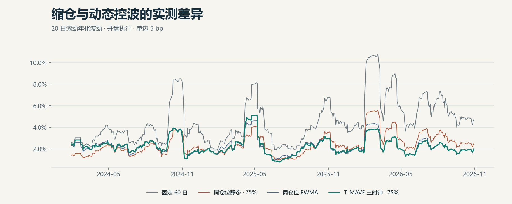

# ChronoETF · 多资产低波配置与 T-MAVE 风险预测

ChronoETF 是一个用五只境内 ETF 做周频配置的量化研究项目。我把推荐系统研究中的 T-MAVE 快慢记忆迁移到市场风险预测，检验股金同时承压时，动态控仓能把波动和回撤降到什么程度，以及为此付出多少收益代价。

## 回测结果

历史回放为 **2024 年 1 月 2 日至 2026 年 10 月 30 日**。每周收盘生成信号，下一交易日开盘模拟成交。下表按单边 **5 bp** 成本计算，2026 年净收益截至 10 月 30 日。

| 策略 | 净年化收益 | 年化波动 | 最大回撤 | 2026 年净收益 |
|---|---:|---:|---:|---:|
| 固定 60 日风险预算 | 9.08% | 4.90% | −5.33% | −0.59% |
| T-MAVE 温和控波 | 7.54% | 2.92% | −2.17% | +0.57% |
| **T-MAVE 强控波** | **6.41%** | **2.38%** | **−1.67%** | **+0.85%** |
| 国债 ETF 单持 | 3.15% | 1.39% | −1.54% | +2.11% |

强控波版相对固定 60 日风险预算**降低年化波动 51.5%**，配对 95% 区间为 **[45.5%, 56.7%]**，校正后 p 值为 **0.002**。净年化收益相应少了 **2.67 个百分点**。2026 年的正收益主要来自国债，动态缩减股票和黄金仓位减轻了亏损拖累。国债单持在当年表现更强，多资产组合在整个回放期取得了更高的净年化收益。



[收益与回撤图](chronoetf/results/20261116-163605/returns_comparison.png) · [逐年绩效及 5/10/25 bp 成本结果](chronoetf/results/20261116-163605/portfolio_metrics.csv) · [国债单持对照](chronoetf/results/20261115-225115/portfolio_metrics.csv)

## 为什么选择这五只 ETF

三只宽基 ETF 覆盖不同的股票风格，黄金提供另一类风险敞口，国债是样本中波动最低的资产。2026 年三只股票 ETF 两两日收益相关性约 **0.86–0.88**，黄金同样出现较深下跌。这个窗口适合检验多资产组合在股票和黄金同时承压时的表现。

| 资产 | 代码 | 2026 年化波动 | 2026 持有收益 |
|---|---|---:|---:|
| 沪深 300 ETF | 510300 | 15.36% | −10.27% |
| 中证 500 ETF | 510500 | 27.81% | −13.83% |
| 创业板 ETF | 159915 | 36.46% | −23.56% |
| 黄金 ETF | 518880 | 31.35% | −12.76% |
| 5 年期国债 ETF | 511010 | 0.68% | +2.11% |

单只 ETF 的波动和持有收益按后复权日线计算，持有收益未扣模拟交易成本。

## T-MAVE 的科研连续性

我在推荐系统中研究的是，**新证据何时只该改变短期状态，何时足以更新长期记忆**。在 ChronoETF 中，交易日、自然日和冲击事件共同决定记忆怎么演化。快状态响应新冲击，持续冲击或跨资产一致性提供更新长期锚点的证据。模型预测股金组合未来五个交易日的方差，据此调整股金仓位。

强控波版的平均股金仓位由 **30.05%** 降到 **15.24%**。匹配股票、黄金的平均仓位后，T-MAVE 相对动态 EWMA 和固定双记忆的额外降波分别为 **0.31%** 和 **0.35%**，区间均跨过零。五日方差预测损失 QLIKE 则从同因子固定双记忆的 **0.716** 降到 **0.694**，显著性对区块长度敏感。冻结版记录了整套策略的历史降波结果，T-MAVE 状态机制的独立贡献继续由同敞口实验验证。

[控波实现](chronoetf/volatility_policy.py) · [预测评分](chronoetf/results/20261116-163605/forecast_scores.csv) · [配对检验](chronoetf/results/20261116-163605/paired_tests.csv)

## 复现

使用 Python 3.13 和可用的中文字体。在仓库根目录运行以下命令生成日线和新的时间戳回测目录。

```powershell
python -m pip install -r requirements.txt
python -B -X utf8 chronoetf/build_data_module.py
python -B -X utf8 chronoetf/backtest.py --vol-target
```

2021–2023 年用于校准。预测按年扩展训练，训练标签在该折首个信号前结束。本页结果冻结于 **2026 年 11 月 16 日**，当前数据截止 **2026 年 10 月 30 日**，均为历史回放。输入文件指纹见实验日志。

[技术说明](chronoetf/README.md) · [实验日志与输入指纹](log.md)
