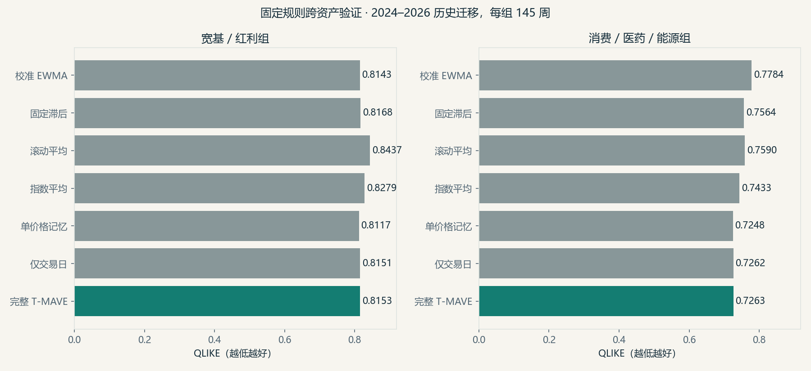

# 候选研究结果：风险预警与跨资产验证

**状态：待用户决定，未写入 HR 文档或技术手册，未替换正式基线。** 本轮是预先固定规则的跨资产历史迁移，不是实盘或未来独立验证。

**建议：保留研究证据，暂不将完整候选升级为正式模型。** 行业组出现预测改善，但宽基/红利组没有复制该优势；主预警没有普遍减少漏报，低风险收益提高门槛也未通过。

完整 T-MAVE 相对校准 EWMA：宽基/红利组 QLIKE 改善 -0.12%，行业组改善 6.70%。两组平均损失差为 0.025591，4 周同步区块 95% 区间 [-0.029728, 0.083667]，Holm p=0.6567。两组共享市场日期、黄金和国债，仅有 145 个同期周，不能把 290 个篮子周当作独立样本。

## 1. 风险预测与简单记忆

| 预测模型 | 原篮子诊断 | 宽基/红利迁移 | 行业迁移 |
|---|---:|---:|---:|
| 校准 EWMA | 0.720649 | 0.814328 | 0.778411 |
| 固定滞后 | 0.703179 | 0.816752 | 0.756430 |
| 滚动平均 | 0.742388 | 0.843737 | 0.759031 |
| 指数平均 | 0.689247 | 0.827855 | 0.743301 |
| 单价格记忆 | 0.667545 | 0.811748 | 0.724838 |
| 仅交易日 | 0.667872 | 0.815124 | 0.726170 |
| 完整 T-MAVE | 0.663007 | 0.815302 | 0.726255 |

原篮子结果只是旧数据上的新增简单对照诊断。新篮子中的单价格与仅交易日和完整模型十分接近；完整机制各部分的独立必要性仍需证据。三种简单记忆都使用相同 7 个静态输入及 4 个额外记忆特征，相同训练和收缩。没有根据测试结果继续调整窗口。

行业组相对校准 EWMA 的 QLIKE 在 2024、2025、2026 三年都更低；宽基/红利组在 2024 年更低、2025 年更高、2026 年相同。历史规则为宽基/红利组在 2026 年选择 gamma=0，退回校准 EWMA；行业组在三个评价年度均选 gamma=0.5。收缩能撤销不受历史证据支持的修正，但不能保证下一年一定优于基线。[年度评分](forecast_scores.csv) · [训练与收缩](train_folds.csv)

## 2. 风险预警实际用途

高风险真值为未来五日实现方差超过该篮子开发期的 90% 分位。主预警把各模型开发期提示频率校准到约 10%；未来提示频率允许漂移。下表显示本轮回放中已经明显偏离开发期预算，不能称为未来同等告警数量。

| 新篮子 | 模型 | 高风险事件 | 命中 | 误报 | 漏报 | 提示频率 |
|---|---|---:|---:|---:|---:|---:|
| 宽基/红利 | 校准 EWMA | 28 | 18 | 38 | 10 | 38.62% |
| 宽基/红利 | 完整 T-MAVE | 28 | 17 | 37 | 11 | 37.24% |
| 行业 | 校准 EWMA | 34 | 18 | 42 | 16 | 41.38% |
| 行业 | 完整 T-MAVE | 34 | 18 | 40 | 16 | 40.00% |

完整模型减少预测低估，并不自动意味着能减少预警遗漏。逐年与同风险门槛路线见 alert_scores.csv；配对区间见 alert_tests.csv。这是监测原型的离线评价，不是已有业务采用或价值证明。

## 3. 投资使用的收益代价

下表为仅开发期匹配实际波动后，回放单边 5 bp 的结果。10/25 bp 和全部简单对照在 portfolio_metrics.csv。保持国债目标、零现金收益、无杠杆，未来实际风险不保证相同。

| 篮子 | 风险匹配策略 | 净年化 | 波动 | 最大回撤 |
|---|---|---:|---:|---:|
| 宽基/红利 | 校准 EWMA · 75 | 6.1366% | 2.1581% | -1.5483% |
| 宽基/红利 | 完整 T-MAVE · 75 | 6.1716% | 2.1925% | -1.5483% |
| 宽基/红利 | 校准 EWMA · 90 | 6.7848% | 2.5969% | -2.0635% |
| 宽基/红利 | 完整 T-MAVE · 90 | 6.7569% | 2.5748% | -2.0635% |
| 行业 | 校准 EWMA · 75 | 5.8644% | 2.6301% | -3.0027% |
| 行业 | 完整 T-MAVE · 75 | 5.8163% | 2.6204% | -2.8518% |
| 行业 | 校准 EWMA · 90 | 6.4253% | 3.2400% | -4.2456% |
| 行业 | 完整 T-MAVE · 90 | 6.3584% | 3.2053% | -4.0498% |

验收表共 23 项条件，未通过 11 项；逐项见 [接受门槛](acceptance_gates.csv)。预测、预警与投资替换的门槛分别判断，不能挑某个改善数字作为整体通过。两篮子、两档在 5/10 bp 下的八项经济联合门槛全部未通过；不能把这些条件计数当作模型质量得分。

## 4. 数据、复现与接受边界

新增六只股票 ETF 的日期、质量和指纹见 data_quality.csv；原黄金和国债继续使用冻结数据。159929/159930 的腾讯后复权请求返回 day 字段，逐段与前复权及不复权请求核对完全一致；供应商口径单列，未独立审计全部公司行动。159930 有四个形成期缺失日期，保留空值，不冒充已确认停牌。新增资产并非按收益排名选择，但属于有目的选择的存续 ETF，不能推广到全部市场或忽略存续选择。

运行 `python -B -X utf8 chronoetf/transfer_research.py` 生成新目录并自动执行本轮核验；`--audit <新生成目录>` 可单独核验；`--summarize <目录>` 生成本候选说明及主图。源码复用原预测、控仓和账户逻辑。原始行情及大型逐日账户留在本地，发布共同周度预测、训练/收缩、关键指标与区间。公开精简目录没有完整账户，因此重新审计须先运行入口生成新目录，并核对 manifest 的输入指纹；不能直接对刚下载的精简目录运行完整账户审计。

本轮完成四项工作：明确风险用途、固定规则迁移、补充简单记忆对照、分开验证预警与经济效果。跨篮子稳定增量、完整机制必要性和低风险收益提高仍按门槛判断；真正前瞻样本尚为 0。用户接受后才更新两个正式 MD。
